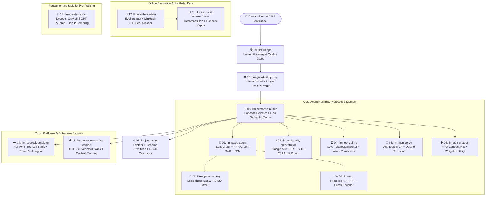

# 🏛️ Cayo Eduardo | AI Engineering Portfolio
### **Desenvolvimento de Software | Sistemas Generativos & LLMs**

---

## 🎯 Visão Geral & Propósito do Portfólio

Sou engenheiro de software com foco na construção, integração e otimização de **sistemas baseados em LLMs, Redes Neurais e LLMOps**.

Este portfólio reúne **16 ecossistemas completos e independentes**, desenvolvidos do zero para solucionar os principais desafios práticos no uso de IA:
- **Orquestração Multi-Agente & Protocolos Concorrentes**: Máquinas de estados finitos (FSM), leilões FIPA distribuídos, grafos acíclicos dirigidos (DAGs) com execução em ondas paralelas e conformidade estrita com o Model Context Protocol (MCP).
- **RAG de Alta Precisão & Memória Cognitiva**: Recuperação em dois estágios com HyDE, Re-Ranking contextual por Cross-Encoder, Reciprocal Rank Fusion (RRF), Top-K via Min-Heaps O(N log K) e decaimento temporal contínuo via Curva de Esquecimento de Ebbinghaus.
- **Segurança Factual, Moderação & Guardrails**: Filtros de injeção direta e indireta de prompt, classificação de risco Llama-Guard 3, anonimização reversível de PII em passe único O(|T|) e sandboxes herméticos.
- **Plataformas de Nuvem Enterprise**: Emulação de padrão industrial e motores nativos de altíssima fidelidade para **AWS Bedrock** (12 pilares) e **Google Cloud Vertex AI** (18 pilares e 4 superpoderes exclusivos).
- **Decisão Neural System-1 Não-Autoregressiva & Calibração**: Inferência de passe único em menos de 5 milissegundos com zero tokens de saída faturados, primitivas estruturadas (`choice`, `noul`, `score`), calibração pós-hoc RLCD e avaliação inline de RAG (`JevEval`).
- **Avaliação Estatística, Síntese de Dados & Deep Learning**: Decomposição atômica de declarações (Atomic Claim Decomposition), consistência inter-juízes via Cohen's Kappa, desduplicação sub-quadrática MinHash LSH O(N * K) e implementação de Transformers com Causal Self-Attention e amostragem Nucleus (Top-P) em PyTorch.

---

## 📋 Tabela Geral dos 16 Projetos do Ecossistema

| # | Repositório | Domínio Arquitetural | Algoritmo / Estrutura Chave | Stack Principal |
| :---: | :--- | :--- | :--- | :--- |
| **01** | [**`llm-sales-agent`**](#11-llm-sales-agent) | Agente de Vendas & FSM | Personalized PageRank O(V+E) & Utilidade Sigmóide | LangGraph, Mem0, Qdrant, FastAPI |
| **02** | [**`llm-antigravity-orchestrator`**](#12-llm-antigravity-orchestrator) | Orquestração & Runtime AGY | Hash Chain SHA-256 Imutável & Hooks Assíncronos | Google AGY SDK, Gemini 1.5, FastAPI |
| **03** | [**`llm-a2a-protocol`**](#13-llm-a2a-protocol) | Protocolo Distribuído Agent-to-Agent | Leilão FIPA Contract Net Multi-Atributo & TTL | FIPA ACL, Redis, CloudEvents, FastAPI |
| **04** | [**`llm-tool-calling`**](#14-llm-tool-calling) | Invocação Estruturada de Tools | DAG Topológico `graphlib`, Ondas Paralelas & Skip Fail-Fast | Tool Engine, OpenTelemetry, MLflow |
| **05** | [**`llm-mcp-server`**](#15-llm-mcp-server) | Servidor Universal MCP | JSON-RPC 2.0, Transporte Duplo (Stdio + SSE) & Sampling | Anthropic MCP, FastAPI SSE, Pydantic v2 |
| **06** | [**`llm-rag`**](#21-llm-rag) | Recuperação Densa & Re-Ranking | Top-K Heap O(N log K), RRF, HyDE & Cross-Encoder | Qdrant, HyDE, Cross-Encoder, FastAPI |
| **07** | [**`llm-agent-memory`**](#22-llm-agent-memory) | Memória Cognitiva Temporal | Decaimento Ebbinghaus & SIMD NumPy MMR | Qdrant, Redis, Vectorized MMR, FastAPI |
| **08** | [**`llm-semantic-router`**](#23-llm-semantic-router) | Roteador em Cascata & Cache | Cache LRU O(1) com TTL & BLAS Cosine Similarity | Qdrant, Cascade Routing, FastAPI |
| **09** | [**`llm-llmops`**](#31-llm-llmops) | Gateway Corporativo & LLMOps | Token Bucket O(1), Circuit Breaker & Quality Gates | Langfuse, Token Bucket, FastAPI |
| **10** | [**`llm-guardrails-proxy`**](#32-llm-guardrails-proxy) | Segurança Factual & Moderação | Regex Único O(\|T\|), De-anonimizador Atômico & Llama-Guard | Llama-Guard 3, PII Vault, FastAPI |
| **11** | [**`llm-eval-suite`**](#41-llm-eval-suite) | Avaliação Offline & Juízes LLM | Atomic Claim Decomposition & Cohen's Kappa | Ragas, DeepEval, G-Eval CoT, FastAPI |
| **12** | [**`llm-synthetic-data`**](#42-llm-synthetic-data) | Síntese de Dados & Curadoria | MinHash LSH Sub-Quadrático O(N * K) & Anti-Loop | Evol-Instruct, MinHash LSH, QLoRA |
| **13** | [**`llm-create-model`**](#43-llm-create-model) | Redes Neurais & Pré-Treinamento | Transformer Decoder-Only, Causal Attention & Top-P | PyTorch, RMSNorm, MLflow, FastAPI |
| **14** | [**`llm-bedrock-emulator`**](#51-llm-bedrock-emulator) | Plataforma de Nuvem (AWS) | 12 Pilares Bedrock: KBR, HITL, Sandboxed Code, DAG Kahn | FastAPI, LangGraph, Qdrant, Ollama |
| **15** | [**`llm-vertex-enterprise-engine`**](#61-llm-vertex-enterprise-engine) | Plataforma de Nuvem (GCP) | 18 Pilares & 4 Superpoderes: Context Caching, CFG, ScaNN | Vertex AI, Gemini 1.5, KFP, BigQuery |
| **16** | [**`llm-jev-engine`**](#71-llm-jev-engine) | Decisão Neural System-1 & Calibração | Primitivas Choice/Noul/Score, Calibração RLCD & JevEval | NumPy SIMD, FastAPI, Pydantic v2, Prometheus |

---

## 🏛️ Topologia do Ecossistema Corporativo de IA

O diagrama abaixo ilustra como esses 16 subsistemas se integram para compor uma plataforma corporativa completa de Inteligência Artificial:

---

## 💎 Apresentação Detalhada dos 16 Projetos por Domínio

---

### 🤖 1. Agentes Autônomos, Ferramentas & Orquestração Multi-Agente

---

#### 1.1 [**`llm-sales-agent`**](https://github.com/cayoesn/llm-sales-agent)
> **Agente Conversacional Especialista em Vendas com Grafo de Conhecimento e FSM Estrita**

- 🎯 **O que o projeto faz:** Conduz conversas de vendas complexas do início ao fim (prospecção, qualificação, apresentação de propostas, contorno de objeções e fechamento), garantindo cumprimento de regras de alçada comercial sem que o modelo invente descontos ou desvie do funil.
- ⚙️ **Arquitetura & Como Funciona:**
  - **FSM com Decisão de Desconto Orientada a Utilidade**: Controla a transição de estados de negociação (*Prospecção → Descoberta → Proposta → Objeções → Fechamento*). Em fases de contraproposta, calcula a chance de fechamento do cliente versus o impacto na margem da empresa, evitando concessões desnecessárias.
  - **Graph-RAG com Personalized PageRank (PPR)**: Utiliza grafo de produtos em NetworkX com passeios aleatórios e reinício para identificar os itens complementares mais relevantes a partir do catálogo corporativo.
  - **Memória Episódica do Cliente**: Armazena e recupera continuamente o histórico e perfil do cliente através do **Mem0** com persistência vetorial no **Qdrant**.
- 🛠️ **Stack Tecnológica:** Python 3.12, LangGraph, Qdrant, Mem0, NetworkX, FastAPI, Pydantic v2.

---

#### 1.2 [**`llm-antigravity-orchestrator`**](https://github.com/cayoesn/llm-antigravity-orchestrator)
> **Orquestrador de Agentes de Alta Eficiência com Google Antigravity SDK & Cadeia Criptográfica**

- 🎯 **O que o projeto faz:** Orquestra agentes autônomos operando em tarefas longas e em segundo plano com o Google Antigravity SDK, provendo auditoria de custos e proteção imutável de logs.
- ⚙️ **Arquitetura & Como Funciona:**
  - **Cadeia Criptográfica de Auditoria (Hash Chain SHA-256)**: Registra cada consumo de tokens e custos financeiros de maneira encadeada por hash, permitindo verificar em tempo linear se qualquer registro foi adulterado.
  - **Ganchos de Interceptação Assíncronos (Hooks)**: Intercepta o ciclo de vida dos agentes antes e depois de cada turno e chamada de ferramenta, permitindo inspeção, aplicação de regras de segurança e cancelamento preventivo.
  - **Rastreabilidade de Tokens de Raciocínio**: Separa com precisão o volume de tokens de entrada, geração de texto e *thinking tokens* de modelos como o Gemini 1.5.
- 🛠️ **Stack Tecnológica:** Python 3.12, Google Antigravity SDK, Gemini 1.5 Pro/Flash, FastAPI, OpenTelemetry, Langfuse.

---

#### 1.3 [**`llm-a2a-protocol`**](https://github.com/cayoesn/llm-a2a-protocol)
> **Protocolo Distribuído Agent-to-Agent com Leilão FIPA Contract Net e Circuit Breaker**

- 🎯 **O que o projeto faz:** Padroniza a comunicação e negociação distribuída entre múltiplos agentes autônomos independentes, permitindo que deleguem tarefas entre si via leilões estruturados com isolamento de falhas.
- ⚙️ **Arquitetura & Como Funciona:**
  - **Leilão FIPA Contract Net Multi-Atributo**: O agente coordenador emite chamadas de proposta (CFP) e avalia as respostas dos agentes concorrentes balanceando pontuação de confiança, reputação histórica, latência e custo financeiro.
  - **Expiração Automática de Lances (TTL)**: Descarta lances que ultrapassem a janela máxima de tolerância temporal antes do fechamento do leilão.
  - **Circuit Breaker Tri-State**: Monitora a taxa de falhas dos agentes participantes e isola automaticamente os que apresentarem degradação, encaminhando mensagens não processadas para filas de reprocessamento (DLQ).
- 🛠️ **Stack Tecnológica:** Python 3.12, FIPA ACL, Redis Pub/Sub, W3C CloudEvents, FastAPI, Pydantic v2.

---

#### 1.4 [**`llm-tool-calling`**](https://github.com/cayoesn/llm-tool-calling)
> **Engine de Execução em Grafo (DAG) com Validação Estrita e Rastreamento Distribuído**

- 🎯 **O que o projeto faz:** Resolve planos de ação complexos gerados por modelos de linguagem, organizando chamadas de ferramentas interdependentes em um grafo e executando-as de forma concorrente e segura.
- ⚙️ **Arquitetura & Como Funciona:**
  - **Escalonador Topológico de DAG (`graphlib`)**: Constrói o grafo de dependências entre as ferramentas a serem executadas e dispara nós paralelos em ondas assíncronas via `asyncio.gather`.
  - **Propagação Rápida de Falhas (Skip Fail-Fast)**: Se uma ferramenta inicial obrigatória falha, todas as ferramentas dependentes são abortadas de imediato, economizando tempo de execução e requisições de rede.
  - **Prevenção de Ciclos**: Valida a estrutura antes do início da execução, garantindo que o plano não contenha dependências circulares infinitas.
- 🛠️ **Stack Tecnológica:** Python 3.12, `graphlib`, OpenTelemetry, MLflow, FastAPI, Pydantic v2.

---

#### 1.5 [**`llm-mcp-server`**](https://github.com/cayoesn/llm-mcp-server)
> **Servidor Universal de Referência do Model Context Protocol (Anthropic MCP)**

- 🎯 **O que o projeto faz:** Disponibiliza ferramentas corporativas, recursos dinâmicos e templates de prompt para qualquer cliente compatível com o padrão aberto Model Context Protocol (como Claude Desktop, IDEs e agentes customizados).
- ⚙️ **Arquitetura & Como Funciona:**
  - **Primitivas MCP Completas**: Provê registro dinâmico de ferramentas (*Tools*), templates de recursos (*Resources*), catálogos de instruções (*Prompts*), inversão de amostragem (*Sampling*) e delimitação de diretórios seguros (*Roots*).
  - **Suporte a Transporte Duplo**: Funciona via **Stdio** para integração local transparente e via **FastAPI SSE** (Server-Sent Events) para microsserviços distribuídos em nuvem.
- 🛠️ **Stack Tecnológica:** Python 3.12, Anthropic MCP Specification, JSON-RPC 2.0, FastAPI SSE, Pydantic v2.

---

### 🔍 2. RAG Avançado, Memória Cognitiva & Roteamento Semântico

---

#### 2.1 [**`llm-rag`**](https://github.com/cayoesn/llm-rag)
> **Pipeline RAG de Alta Precisão com Min-Heaps O(N log K), RRF & Cross-Encoder**

- 🎯 **O que o projeto faz:** Realiza busca semântica e contextual avançada em bases de conhecimento corporativas, superando abordagens simples de RAG que recuperam documentos genéricos ou fora de foco.
- ⚙️ **Arquitetura & Como Funciona:**
  - **Top-K via Min-Heaps O(N log K)**: Seleciona eficientemente os documentos mais relevantes do índice sem incorrer no custo computacional de ordenar toda a base.
  - **Reciprocal Rank Fusion (RRF)**: Mescla resultados de busca vetorial densa, busca esparsa e correspondência de palavras-chave, gerando uma ordenação equilibrada.
  - **HyDE Assíncrono (Hypothetical Document Embeddings)**: Gera uma resposta preliminar hipotética para guiar a busca vetorial no mesmo espaço de representação das respostas definitivas.
  - **Re-Ranking e Compressão de Contexto**: Utiliza Cross-Encoder para refinar os candidatos finais e remove trechos irrelevantes antes do envio para o modelo gerador.
- 🛠️ **Stack Tecnológica:** Python 3.12, Qdrant, Sentence-Transformers, Cross-Encoder, FastAPI, Pydantic v2.

---

#### 2.2 [**`llm-agent-memory`**](https://github.com/cayoesn/llm-agent-memory)
> **Motor de Memória Cognitiva de Longo Prazo com Curva de Ebbinghaus & SIMD NumPy MMR**

- 🎯 **O que o projeto faz:** Gerencia a memória de longo prazo de assistentes conversacionais, retendo preferências e fatos importantes enquanto descarta ruídos e dados obsoletos para poupar a janela de contexto.
- ⚙️ **Arquitetura & Como Funciona:**
  - **Decaimento Contínuo de Retenção (Ebbinghaus)**: Aplica decaimento temporal nas memórias conforme o tempo sem acesso aumenta, fortalecendo a estabilidade das memórias sempre que são relembradas ou confirmadas.
  - **Diversificação Vetorizada via NumPy (MMR)**: Seleciona fatos relevantes e evita redundâncias no prompt final através do cálculo matricial de similaridade e diversidade.
  - **Arquitetura de Três Camadas**: Transfere memórias recentes mantidas em cache no Redis para agrupamentos consolidados de longo prazo no Qdrant.
- 🛠️ **Stack Tecnológica:** Python 3.12, Qdrant, Redis, NumPy, FastAPI, Pydantic v2.

---

#### 2.3 [**`llm-semantic-router`**](https://github.com/cayoesn/llm-semantic-router)
> **Roteador Semântico com Seleção em Cascata e Cache Semântico LRU O(1) Sub-5ms**

- 🎯 **O que o projeto faz:** Analisa a intenção semântica de cada requisição para responder consultas frequentes instantaneamente via cache ou despachar a chamada para o modelo mais econômico capaz de atendê-la.
- ⚙️ **Arquitetura & Como Funciona:**
  - **Cache Semântico LRU O(1)**: Mantém em memória respostas de alta similaridade semântica com tempo de resposta abaixo de 5 milissegundos e descarte automático por inatividade ou tempo de vida (TTL).
  - **Roteamento em Cascata**: Direciona perguntas simples e operacionais para modelos menores e locais, reservando os modelos de ponta para raciocínios analíticos de alta complexidade.
- 🛠️ **Stack Tecnológica:** Python 3.12, Qdrant, FastAPI, Pydantic v2.

---

### 🛡️ 3. Segurança, Moderação & Gateway Industrial (LLMOps)

---

#### 3.1 [**`llm-llmops`**](https://github.com/cayoesn/llm-llmops)
> **Gateway Industrial de LLMOps com Token Bucket O(1), Circuit Breaker e Quality Gates**

- 🎯 **O que o projeto faz:** Atua como o ponto único de entrada para chamadas a modelos de linguagem na empresa, centralizando cotas de tráfego, isolando falhas de provedores e monitorando métricas em tempo real.
- ⚙️ **Arquitetura & Como Funciona:**
  - **Limitador de Quotas Token Bucket O(1)**: Aplica controle de requisições por minuto e tokens por minuto com consumo computacional mínimo e sem travas de banco de dados.
  - **Circuit Breaker com Fallback**: Detecta indisponibilidades ou erros frequentes no provedor principal e chaveia imediatamente para respostas de contingência seguras.
  - **Esteira de Qualidade (Quality Gates)**: Valida versões de prompts e modelos antes da publicação em produção para evitar regressões comportamentais ou elevação imprevista de custos.
- 🛠️ **Stack Tecnológica:** Python 3.12, Langfuse, Prometheus, FastAPI, Pydantic v2.

---

#### 3.2 [**`llm-guardrails-proxy`**](https://github.com/cayoesn/llm-guardrails-proxy)
> **Proxy de Segurança Industrial com Regex Unificado O(|T|), Cofre PII e Llama-Guard 3**

- 🎯 **O que o projeto faz:** Protege sistemas corporativos contra injeção de prompt adversarial, vazamento acidental de dados pessoais (PII) e geração de conteúdo ofensivo ou tóxico.
- ⚙️ **Arquitetura & Como Funciona:**
  - **Sanitização de Dados em Passe Único**: Localiza e substitui dados sensíveis (CPFs, cartões de crédito e e-mails) por identificadores protegidos em uma única passagem pelo texto.
  - **Restauração Segura**: De-anonimiza os dados protegidos na resposta que retorna ao usuário sem mantê-los expostos no histórico dos modelos.
  - **Moderação com Llama-Guard 3 & Inspeção Base64**: Decodifica payloads camuflados e avalia os prompts contra as categorias de risco padronizadas da Meta.
- 🛠️ **Stack Tecnológica:** Python 3.12, Llama-Guard 3, FastAPI, Pydantic v2.

---

### 📊 4. Avaliação Offline, Dados Sintéticos & Fundamentos de IA

---

#### 4.1 [**`llm-eval-suite`**](https://github.com/cayoesn/llm-eval-suite)
> **Framework de Avaliação Contínua com Decomposição Atômica de Claims & Cohen's Kappa**

- 🎯 **O que o projeto faz:** Avalia a precisão e a fidelidade factual de sistemas de RAG e agentes, identificando alucinações e mensurando a consistência estatística de juízes automáticos.
- ⚙️ **Arquitetura & Como Funciona:**
  - **Decomposição Atômica de Afirmações**: Quebra respostas longas em declarações unitárias independentes para checar se cada uma possui comprovação direta no material de suporte.
  - **Concordância Estatística Inter-Juízes (Cohen's Kappa)**: Mede o grau de concordância real entre múltiplos avaliadores automáticos, descartando coincidências aleatórias.
  - **Relatórios de Desempenho**: Gera sumários estruturados em formato Markdown e JSON para acompanhamento contínuo em pipelines de integração.
- 🛠️ **Stack Tecnológica:** Python 3.12, Ragas, DeepEval, G-Eval CoT, FastAPI, Pydantic v2.

---

#### 4.2 [**`llm-synthetic-data`**](https://github.com/cayoesn/llm-synthetic-data)
> **Gerador e Curador Automatizado de Dados com MinHash LSH Sub-Quadrático & Anti-Loop**

- 🎯 **O que o projeto faz:** Gera e purifica grandes bases de dados de treinamento sintético para modelos de linguagem, removendo duplicatas e descartando alucinações repetitivas.
- ⚙️ **Arquitetura & Como Funciona:**
  - **Deduplicação MinHash LSH Sub-Quadrática O(N * K)**: Utiliza permutações e particionamento em bandas para detectar textos redundantes rapidamente, sem precisar comparar cada documento com todos os demais.
  - **Filtro de Degeneração por Repetição**: Detecta sequências repetidas em loop geradas por modelos de amostragem descalibrada e remove automaticamente os registros defeituosos.
  - **Geração via Evol-Instruct**: Aplica mutações de complexidade e amplitude sobre instruções simples, preparando dados formatados para fine-tuning supervisionado (**QLoRA**).
- 🛠️ **Stack Tecnológica:** Python 3.12, MinHash LSH, Evol-Instruct, QLoRA, FastAPI, Pydantic v2.

---

#### 4.3 [**`llm-create-model`**](https://github.com/cayoesn/llm-create-model)
> **Transformer Decoder-Only (Mini-GPT) do Zero em PyTorch com Causal Attention & Top-P**

- 🎯 **O que o projeto faz:** Implementa uma rede neural Transformer do zero em nível fundamental, demonstrando domínio aprofundado dos blocos de atenção causal e estratégias de geração de texto.
- ⚙️ **Arquitetura & Como Funciona:**
  - **Arquitetura Decoder-Only em PyTorch**: Implementação artesanal de blocos de Multi-Head Causal Self-Attention com máscara triangular, projeções de Query, Key e Value, normalização de camada e conexões residuais.
  - **Mecanismos de Amostragem Autoregressiva**: Suporte a amostragem por núcleo (**Top-P / Nucleus Sampling**), **Top-K**, ajuste de temperatura e penalização de repetição de palavras.
  - **Esteira de Treinamento e Checkpoints**: Cálculo de perdas em lote, persistência periódica de pesos e registro de métricas no MLflow.
- 🛠️ **Stack Tecnológica:** Python 3.12, PyTorch, MLflow, FastAPI, Pydantic v2.

---

### ☁️ 5. Emulação de Plataformas em Nuvem Enterprise (AWS Bedrock)

---

#### 5.1 [**`llm-bedrock-emulator`**](https://github.com/cayoesn/llm-bedrock-emulator)
> **Emulador Completo de Alta Fidelidade dos 12 Pilares Corporativos do AWS Bedrock**

- 🎯 **O que o projeto faz:** Emula os principais serviços corporativos de IA generativa da Amazon Web Services (AWS Bedrock) em ambiente local ou hermético, facilitando testes sem custo de nuvem e sem tráfego de dados sensíveis na internet.
- ⚙️ **Arquitetura & Como Funciona:**
  - **Agentes ReAct e Aprovação Humana (HITL)**: Orquestra múltiplos agentes especialistas e permite pausas para aprovação de operadores antes da execução de comandos sensíveis.
  - **Knowledge Bases (KBR)**: Implementa divisão hierárquica pai-filho de documentos e busca vetorial com re-ranking via modelos locais ONNX.
  - **Execução Segura de Código (Code Interpreter)**: Roda trechos de código gerados pelo modelo dentro de sandboxes isolados com controle estrito de memória e tempo.
  - **Prompt Flows em Grafo (DAG)**: Resolve fluxos de instruções interdependentes com detecção e bloqueio de dependências circulares.
- 🛠️ **Stack Tecnológica:** Python 3.12, FastAPI, LangGraph, Qdrant, Ollama, Docker.

---

### 🌐 6. Arquitetura Corporativa de IA em Nuvem (Google Cloud Vertex AI)

---

#### 6.1 [**`llm-vertex-enterprise-engine`**](https://github.com/cayoesn/llm-vertex-enterprise-engine)
> **Motor Corporativo Nativo dos 18 Pilares e 4 Superpoderes do Google Cloud Vertex AI**

- 🎯 **O que o projeto faz:** Fornece uma implementação nativa e completa dos serviços de IA corporativa do ecossistema Google Cloud Vertex AI, focando em redução drástica de latência e controle estruturado de inferência.
- ⚙️ **Arquitetura & Como Funciona:**
  - **Os 4 Superpoderes do Vertex AI**:
    1. *Context Caching*: Reutiliza contextos longos pré-computados, gerando economia expressiva de custo e tempo de resposta.
    2. *Controlled Generation com CFG*: Garante que o modelo siga estritamente contratos Pydantic v2 sem desvios de sintaxe.
    3. *Multimodal Timestamp Grounding*: Localiza trechos de interesse em conteúdos audiovisuais gerando referências temporais no formato de minutos e segundos.
    4. *Predição em Lote Assíncrona*: Processa grandes volumes de registros JSONL concorrentemente com controle de vazão por semáforo.
  - **Serviços Corporativos Integrados**: Inclui orquestração de pipelines (KFP) via grafos acíclicos, busca em bancos vetoriais otimizados (ScaNN), geração de consultas SQL seguras sobre o BigQuery e torneios comparativos cego de modelos (AutoSxS).
- 🛠️ **Stack Tecnológica:** Python 3.12, Google Cloud Vertex AI SDK, Gemini 1.5 Pro, Kubeflow Pipelines, BigQuery, ScaNN, FastAPI.

---

### ⚡ 7. Decisão Neural System-1 Não-Autoregressiva & Calibração Estatística

---

#### 7.1 [**`llm-jev-engine`**](https://github.com/cayoesn/llm-jev-engine)
> **Motor de Decisão Neural System-1 Não-Autoregressivo de Passe Único com Calibração RLCD & JevEval**

- 🎯 **O que o projeto faz:** Substitui chamadas lentas e caras a LLMs generativos (System-2) em tarefas de roteamento, classificação, verificação factual e pontuação por um motor de decisão neural não-autoregressivo de passe único (System-1) inspirado na arquitetura Jev (`jev.dev`), entregando distribuições de probabilidade calibradas em menos de 5 milissegundos com zero tokens de saída faturados.
- ⚙️ **Arquitetura & Como Funciona:**
  - **Três Primitivas Nativas de Passe Único (`choice`, `noul`, `score`)**: Executa seleção multiclasse de 2 a 255 opções (`choice`), verificação proposicional binária com intervalo de credibilidade de Wilson a 95% (`noul`) e avaliação ordinal contínua de rubricas de 2 a 10 níveis com valor esperado e variância (`score`), eliminando falhas de formatação JSON e geração autoregressiva de tokens.
  - **Calibração Estatística Pós-Hoc RLCD**: Ajusta logits brutos por escalonamento de temperatura numericamente estável e escalonamento logístico de Platt, otimizando Expected Calibration Error (ECE), Brier Score e Negative Log-Likelihood via busca de seção áurea vetorizada em NumPy SIMD/BLAS.
  - **Amostragem Paralela de Estado Compartilhado & Portão de Confiança**: Codifica o estado de entrada uma única vez e avalia múltiplas perguntas concorrentemente via `asyncio.gather` com cache LRU O(1), roteando cada decisão por limiares determinísticos de confiança (`AUTO_EXECUTE`, `FALLBACK_SYSTEM2` ou `ESCALATE_HITL`) e registrando auditoria criptográfica encadeada por HMAC-SHA256.
  - **Os 4 Fluxos Corporativos Reais & Ganhos Quantificados**:
    1. *AI Gateway & Roteamento em Cascata Hot-Path*: Avalia rota computacional, segurança anti-jailbreak e complexidade analítica em menos de 3 milissegundos, defletindo entre 65% e 80% do tráfego trivial ou adversarial antes de acionar LLMs de fronteira (ganho de velocidade superior a 340 vezes).
    2. *Triagem de Tickets de CRM & Suporte com Automação Governada por Confiança*: Classifica fila de atendimento, urgência de SLA, presença de bug técnico e nível de frustração do cliente em um único passe compartilhado, reduzindo em 70% o consumo de tokens de entrada e eliminando 100% dos tokens de saída.
    3. *`JevEval` — Juiz Inline Anti-Alucinação em Produção para Pipelines RAG*: Substitui o paradigma lento de LLM-as-a-Judge offline por verificação inline em tempo real (menos de 3 milissegundos) de fidelidade ao contexto, conformidade de políticas e qualidade da resposta antes da entrega ao usuário final.
    4. *Motor de Benchmark FinOps de Saída Não-Tarifada (Unmetered-Output)*: Simula e audita em tempo real a economia financeira e computacional em escala corporativa, demonstrando redução líquida superior a 99% nos custos mensais de inferência em comparação a modelos generativos System-2.
- 🛠️ **Stack Tecnológica:** Python 3.12, FastAPI, NumPy BLAS/SIMD, Pydantic v2, AsyncIO, Prometheus, Langfuse, Docker.

---

## 🛠️ Matriz Geral de Competências & Domínios Corporativos

| Domínio de Engenharia | Tecnologias, Frameworks e Protocolos Dominados |
| :--- | :--- |
| **Plataformas de Nuvem Enterprise** | Google Cloud Vertex AI, AWS Bedrock, Kubeflow Pipelines (KFP), BigQuery NL2SQL, Cloud Storage (`gs://`), Google Model Armor |
| **Decisão System-1 & Calibração** | Inferência Não-Autoregressiva de Passe Único (Jev), Primitivas Choice/Noul/Score, Calibração RLCD (ECE/Brier/Platt), JevEval Inline RAG |
| **Frameworks de Agentes & Protocolos** | Model Context Protocol (MCP), Google Antigravity (AGY) SDK, LangGraph, FIPA Contract Net Protocol, ReAct, W3C CloudEvents |
| **Bancos Vetoriais & Motores de Busca** | ScaNN (MIPS), Qdrant, PostgreSQL (pgvector), Redis (Semantic Cache), HyDE, FlashRank ONNX, Cross-Encoders |
| **Segurança, Moderação & Guardrails** | Google Model Armor, Llama-Guard 3, Sanitizador Criptográfico Reversível de PII, gVisor Code Execution Sandbox, Anti-Jailbreak |
| **LLMOps, Avaliação & Observabilidade** | Vertex AutoSxS (Qui-Quadrado), Ragas, DeepEval, G-Eval CoT, Langfuse, OpenTelemetry, MLflow, Prometheus, Grafana, Jaeger |
| **Engenharia de Software & Runtime** | Python 3.12, FastAPI (REST & SSE), AsyncIO Concorrente, Pydantic v2, PyTorch, Docker & Docker Compose, Ruff, Mypy Strict |

---

  Desenvolvido por <b>Cayo Eduardo</b>.

