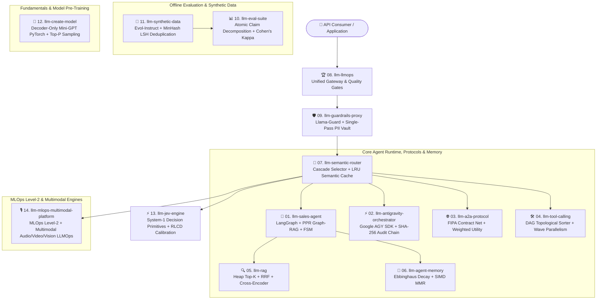

# 🏛️ Cayo Eduardo | AI Engineering Portfolio
### **Software Engineering | Generative AI Systems & LLMs**

---

## 🎯 Portfolio Overview & Engineering Focus

I am a software engineer specializing in architecting, integrating, and optimizing **production-grade LLM systems, neural networks, MLOps, and LLMOps platforms**.

This portfolio brings together **14 complete, standalone engineering ecosystems** built from the ground up to solve core production challenges in applied AI:
- **Multi-Agent Orchestration & Distributed Protocols**: Strict finite state machines (FSMs), distributed FIPA Contract Net auctions, directed acyclic graphs (DAGs) with parallel wave execution, and cryptographically tamper-evident execution logs.
- **High-Precision RAG & Cognitive Memory**: Two-stage retrieval with HyDE, contextual cross-encoder reranking, Reciprocal Rank Fusion (RRF), O(N log K) min-heap Top-K selection, and continuous temporal memory decay modeled after the Ebbinghaus forgetting curve.
- **Factual Safety, Moderation & Guardrails**: Direct and indirect prompt-injection defense, Llama-Guard 3 risk classification, single-pass O(|T|) reversible PII redaction, and Base64 payload inspection.
- **Non-Autoregressive System-1 Neural Decision & Calibration**: Single-pass inference under 5 ms with zero metered output tokens, structured decision primitives (`choice`, `noul`, `score`), post-hoc RLCD calibration, and inline RAG verification (`JevEval`).
- **Level-2 MLOps & Open-Source Multimodal LLMOps**: End-to-end predictive and generative lifecycle governance unifying **Feast Feature Store**, **DVC/CML**, **MLflow**, **Apache Airflow**, **Kubeflow**, **Whisper ASR**, **ONNX Runtime**, and concurrent **Text, Audio, Image, and Video** fusion with cross-modal synergy detection, automated drift-triggered retraining, and FinOps/GDPR/LGPD governance.
- **Statistical Evaluation, Synthetic Data & Deep Learning Fundamentals**: Atomic Claim Decomposition, inter-rater agreement via Cohen's Kappa, sub-quadratic O(N * K) MinHash LSH deduplication, and from-scratch PyTorch Decoder-Only Transformers with Causal Self-Attention and Nucleus (Top-P) sampling.

---

## 📋 Master Summary of the 14 Ecosystem Repositories

| # | Repository | Architectural Domain | Key Algorithm / Data Structure | Core Stack |
| :---: | :--- | :--- | :--- | :--- |
| **01** | [**`llm-sales-agent`**](#11-llm-sales-agent) | Sales Agent & Strict FSM | Personalized PageRank O(V+E) & Sigmoid Utility | LangGraph, Mem0, Qdrant, FastAPI |
| **02** | [**`llm-antigravity-orchestrator`**](#12-llm-antigravity-orchestrator) | Agent Orchestration & AGY Runtime | Immutable SHA-256 Hash Chain & Async Hooks | Google AGY SDK, Gemini 1.5, FastAPI |
| **03** | [**`llm-a2a-protocol`**](#13-llm-a2a-protocol) | Distributed Agent-to-Agent Protocol | Multi-Attribute FIPA Contract Net Auction & TTL | FIPA ACL, Redis, CloudEvents, FastAPI |
| **04** | [**`llm-tool-calling`**](#14-llm-tool-calling) | Structured Tool Invocation | `graphlib` Topological DAG, Parallel Waves & Fail-Fast Skip | Tool Engine, OpenTelemetry, MLflow |
| **05** | [**`llm-rag`**](#21-llm-rag) | Dense Retrieval & Reranking | Top-K Min-Heap O(N log K), RRF, HyDE & Cross-Encoder | Qdrant, HyDE, Cross-Encoder, FastAPI |
| **06** | [**`llm-agent-memory`**](#22-llm-agent-memory) | Temporal Cognitive Memory | Ebbinghaus Decay & SIMD NumPy MMR | Qdrant, Redis, Vectorized MMR, FastAPI |
| **07** | [**`llm-semantic-router`**](#23-llm-semantic-router) | Cascade Router & Semantic Cache | O(1) LRU Cache with TTL & BLAS Cosine Similarity | Qdrant, Cascade Routing, FastAPI |
| **08** | [**`llm-llmops`**](#31-llm-llmops) | Enterprise AI Gateway & LLMOps | O(1) Token Bucket, Circuit Breaker & Quality Gates | Langfuse, Token Bucket, FastAPI |
| **09** | [**`llm-guardrails-proxy`**](#32-llm-guardrails-proxy) | Factual Safety & Moderation | Single-Pass O(\|T\|) Regex, Atomic De-Anonymizer & Llama-Guard | Llama-Guard 3, PII Vault, FastAPI |
| **10** | [**`llm-eval-suite`**](#41-llm-eval-suite) | Offline Evaluation & LLM Judges | Atomic Claim Decomposition & Cohen's Kappa | RAGAS, DeepEval, G-Eval CoT, FastAPI |
| **11** | [**`llm-synthetic-data`**](#42-llm-synthetic-data) | Synthetic Data & Curation | Sub-Quadratic MinHash LSH O(N * K) & Anti-Loop Filter | Evol-Instruct, MinHash LSH, QLoRA |
| **12** | [**`llm-create-model`**](#43-llm-create-model) | Neural Networks & Pre-Training | Decoder-Only Transformer, Causal Attention & Top-P | PyTorch, RMSNorm, MLflow, FastAPI |
| **13** | [**`llm-jev-engine`**](#51-llm-jev-engine) | System-1 Neural Decision & Calibration | Choice/Noul/Score Primitives, RLCD Calibration & JevEval | NumPy SIMD, FastAPI, Pydantic v2, Prometheus |
| **14** | [**`llm-mlops-multimodal-platform`**](#61-llm-mlops-multimodal-platform) | Level-2 MLOps & Multimodal LLMOps | Feast PIT Join O(Q log M), PSI/KS Drift, LoRA & Audio/Video/ONNX Fusion | Feast, DVC/CML, MLflow, Airflow, Whisper, ONNX |

---

## 🏛️ Enterprise AI Ecosystem Topology

The diagram below illustrates how these 14 subsystems integrate to form a unified, production-ready enterprise AI platform:

---

## 💎 Detailed Breakdown of the 14 Projects by Domain

---

### 🤖 1. Autonomous Agents, Tools & Multi-Agent Orchestration

---

#### 1.1 [**`llm-sales-agent`**](https://github.com/cayoesn/llm-sales-agent)
> **Conversational Sales Specialist Agent with Knowledge Graph and Strict FSM**

- 🎯 **What it does:** Drives complex end-to-end sales conversations (prospecting, discovery, proposal presentation, objection handling, and closing) while enforcing commercial approval policies so the model never hallucinates discounts or deviates from the sales funnel.
- ⚙️ **Architecture & Key Mechanisms:**
  - **Utility-Driven Discount FSM**: Enforces negotiation state transitions (*Prospecting → Discovery → Proposal → Objections → Closing*). During counter-offers, it models closing probability against gross margin impact to avoid unnecessary concessions.
  - **Graph-RAG with Personalized PageRank (PPR)**: Runs random walks with restart over a NetworkX product graph to surface the highest-relevance complementary items across the enterprise catalog.
  - **Episodic Customer Memory**: Continuously stores and retrieves customer profiles and interaction history via **Mem0** backed by **Qdrant** vector persistence.
- 🛠️ **Tech Stack:** Python 3.12, LangGraph, Qdrant, Mem0, NetworkX, FastAPI, Pydantic v2.

---

#### 1.2 [**`llm-antigravity-orchestrator`**](https://github.com/cayoesn/llm-antigravity-orchestrator)
> **High-Efficiency Agent Orchestrator with Google Antigravity SDK & Cryptographic Audit Chain**

- 🎯 **What it does:** Orchestrates autonomous agents executing long-running background workflows on the Google Antigravity SDK, delivering granular cost governance and tamper-evident audit logging.
- ⚙️ **Architecture & Key Mechanisms:**
  - **Cryptographic Audit Trail (SHA-256 Hash Chain)**: Links every token consumption record and cost event into a hash chain, enabling linear-time verification of log integrity.
  - **Asynchronous Interception Hooks**: Intercepts the agent lifecycle before and after every turn and tool invocation for inspection, policy enforcement, and preemptive cancellation.
  - **Reasoning Token Accounting**: Precisely separates input tokens, text generation tokens, and *thinking tokens* across models such as Gemini 1.5.
- 🛠️ **Tech Stack:** Python 3.12, Google Antigravity SDK, Gemini 1.5 Pro/Flash, FastAPI, OpenTelemetry, Langfuse.

---

#### 1.3 [**`llm-a2a-protocol`**](https://github.com/cayoesn/llm-a2a-protocol)
> **Distributed Agent-to-Agent Protocol with FIPA Contract Net Auction & Circuit Breaker**

- 🎯 **What it does:** Standardizes distributed communication and task delegation across independent autonomous agents through structured auctions with built-in fault isolation.
- ⚙️ **Architecture & Key Mechanisms:**
  - **Multi-Attribute FIPA Contract Net Auction**: The coordinator broadcasts Calls for Proposals (CFPs) and scores competing agent bids across confidence, historical reputation, latency, and cost.
  - **Automatic Bid Expiration (TTL)**: Discards stale bids that exceed the maximum time-to-live tolerance before auction close.
  - **Tri-State Circuit Breaker**: Tracks per-agent failure rates, automatically isolates degraded peers, and routes unprocessed messages to dead-letter queues (DLQ) for recovery.
- 🛠️ **Tech Stack:** Python 3.12, FIPA ACL, Redis Pub/Sub, W3C CloudEvents, FastAPI, Pydantic v2.

---

#### 1.4 [**`llm-tool-calling`**](https://github.com/cayoesn/llm-tool-calling)
> **DAG Execution Engine with Strict Validation & Distributed Tracing**

- 🎯 **What it does:** Resolves complex multi-step action plans produced by LLMs, compiling interdependent tool calls into a directed acyclic graph for safe concurrent execution.
- ⚙️ **Architecture & Key Mechanisms:**
  - **Topological DAG Scheduler (`graphlib`)**: Builds the dependency graph across tool invocations and dispatches independent nodes in concurrent asynchronous waves via `asyncio.gather`.
  - **Fail-Fast Skip Propagation**: Immediately aborts all downstream dependent tools if a required upstream tool fails, eliminating wasted compute and network round trips.
  - **Cycle Prevention**: Validates graph topology prior to execution to reject circular dependencies and infinite loops.
- 🛠️ **Tech Stack:** Python 3.12, `graphlib`, OpenTelemetry, MLflow, FastAPI, Pydantic v2.

---

### 🔍 2. Advanced RAG, Cognitive Memory & Semantic Routing

---

#### 2.1 [**`llm-rag`**](https://github.com/cayoesn/llm-rag)
> **High-Precision RAG Pipeline with O(N log K) Min-Heaps, RRF & Cross-Encoder**

- 🎯 **What it does:** Executes high-precision semantic and contextual retrieval over enterprise knowledge bases, outperforming naive RAG setups that retrieve generic or off-target chunks.
- ⚙️ **Architecture & Key Mechanisms:**
  - **O(N log K) Min-Heap Top-K Selection**: Extracts top-ranked documents efficiently without paying the full sorting overhead across the entire index.
  - **Reciprocal Rank Fusion (RRF)**: Blends dense vector retrieval, sparse retrieval, and lexical keyword matching into a single balanced ranking.
  - **Async HyDE (Hypothetical Document Embeddings)**: Synthesizes a hypothetical answer to project the query into the same embedding manifold as authoritative target documents.
  - **Cross-Encoder Reranking & Context Compression**: Scores final candidates with a cross-encoder and strips irrelevant spans before prompt assembly.
- 🛠️ **Tech Stack:** Python 3.12, Qdrant, Sentence-Transformers, Cross-Encoder, FastAPI, Pydantic v2.

---

#### 2.2 [**`llm-agent-memory`**](https://github.com/cayoesn/llm-agent-memory)
> **Long-Term Cognitive Memory Engine with Ebbinghaus Decay & SIMD NumPy MMR**

- 🎯 **What it does:** Manages long-term conversational memory for AI assistants, retaining high-signal user preferences and facts while pruning noise and stale entries to preserve context window efficiency.
- ⚙️ **Architecture & Key Mechanisms:**
  - **Continuous Retention Decay (Ebbinghaus Curve)**: Decays memory salience as elapsed time without recall increases, while reinforcing stability whenever a memory is accessed or confirmed.
  - **Vectorized NumPy Diversity Selection (MMR)**: Selects relevant yet non-redundant facts for the final prompt via matrix-level Maximal Marginal Relevance computation.
  - **Three-Tier Memory Architecture**: Promotes hot episodic memories cached in Redis into consolidated long-term vector clusters in Qdrant.
- 🛠️ **Tech Stack:** Python 3.12, Qdrant, Redis, NumPy, FastAPI, Pydantic v2.

---

#### 2.3 [**`llm-semantic-router`**](https://github.com/cayoesn/llm-semantic-router)
> **Cascade Semantic Router with Sub-5ms O(1) LRU Semantic Cache**

- 🎯 **What it does:** Classifies incoming request intent semantically to serve recurring queries immediately from cache or route them to the most cost-effective model capable of fulfilling the task.
- ⚙️ **Architecture & Key Mechanisms:**
  - **O(1) LRU Semantic Cache**: Serves semantically equivalent responses in under 5 ms with automatic eviction by recency or time-to-live (TTL).
  - **Cascade Model Routing**: Dispatches straightforward operational queries to smaller, lower-cost models while reserving frontier models for high-complexity analytical reasoning.
- 🛠️ **Tech Stack:** Python 3.12, Qdrant, FastAPI, Pydantic v2.

---

### 🛡️ 3. Security, Moderation & Enterprise AI Gateway (LLMOps)

---

#### 3.1 [**`llm-llmops`**](https://github.com/cayoesn/llm-llmops)
> **Enterprise LLMOps Gateway with O(1) Token Bucket, Circuit Breaker & Quality Gates**

- 🎯 **What it does:** Serves as the unified ingress gateway for enterprise LLM traffic, enforcing rate quotas, isolating upstream provider outages, and tracking real-time operational telemetry.
- ⚙️ **Architecture & Key Mechanisms:**
  - **O(1) Token Bucket Rate Limiter**: Enforces requests-per-minute (RPM) and tokens-per-minute (TPM) quotas with minimal compute overhead and zero database locking.
  - **Circuit Breaker with Safe Fallback**: Detects upstream latency spikes or error bursts and switches cleanly to safe fallback responses.
  - **Release Quality Gates**: Validates prompt revisions and model upgrades prior to production rollout to catch behavioral regressions and unexpected cost spikes.
- 🛠️ **Tech Stack:** Python 3.12, Langfuse, Prometheus, FastAPI, Pydantic v2.

---

#### 3.2 [**`llm-guardrails-proxy`**](https://github.com/cayoesn/llm-guardrails-proxy)
> **Production Security Proxy with Unified O(|T|) Regex, PII Vault & Llama-Guard 3**

- 🎯 **What it does:** Protects enterprise AI applications against adversarial prompt injection, accidental Personally Identifiable Information (PII) leakage, and unsafe or toxic outputs.
- ⚙️ **Architecture & Key Mechanisms:**
  - **Single-Pass PII Redaction**: Detects and replaces sensitive entities (tax IDs, credit cards, and email addresses) with opaque vault tokens in a single O(|T|) scan.
  - **Atomic Safe Restoration**: Re-hydrates protected tokens in the response returned to the caller without exposing raw PII to upstream model providers or logs.
  - **Llama-Guard 3 Moderation & Base64 Inspection**: Decodes obfuscated payloads and classifies prompts against Meta's standardized safety taxonomy.
- 🛠️ **Tech Stack:** Python 3.12, Llama-Guard 3, FastAPI, Pydantic v2.

---

### 📊 4. Offline Evaluation, Synthetic Data & AI Fundamentals

---

#### 4.1 [**`llm-eval-suite`**](https://github.com/cayoesn/llm-eval-suite)
> **Continuous Evaluation Framework with Atomic Claim Decomposition & Cohen's Kappa**

- 🎯 **What it does:** Measures factual accuracy and faithfulness across RAG pipelines and agentic workflows, pinpointing hallucinations and quantifying automated judge reliability.
- ⚙️ **Architecture & Key Mechanisms:**
  - **Atomic Claim Decomposition**: Breaks long-form answers into atomic factual statements and verifies whether each claim is directly supported by retrieved context.
  - **Inter-Rater Agreement (Cohen's Kappa)**: Quantifies true agreement across multiple automated LLM judges beyond chance coincidence.
  - **CI-Ready Reporting**: Outputs structured Markdown and JSON evaluation reports for continuous tracking in CI/CD pipelines.
- 🛠️ **Tech Stack:** Python 3.12, RAGAS, DeepEval, G-Eval CoT, FastAPI, Pydantic v2.

---

#### 4.2 [**`llm-synthetic-data`**](https://github.com/cayoesn/llm-synthetic-data)
> **Automated Synthetic Dataset Generator & Curator with Sub-Quadratic MinHash LSH & Anti-Loop Filtering**

- 🎯 **What it does:** Generates and curates high-quality synthetic training corpora for LLM fine-tuning, eliminating near-duplicates and repetitive generation artifacts.
- ⚙️ **Architecture & Key Mechanisms:**
  - **Sub-Quadratic O(N * K) MinHash LSH Deduplication**: Applies min-wise permutations and locality-sensitive banding to identify near-duplicate samples without quadratic all-pairs comparisons.
  - **Repetition Degeneration Filter**: Detects looping n-gram sequences produced by poorly calibrated sampling and automatically drops degraded samples.
  - **Evol-Instruct Synthesis**: Applies breadth and depth complexity mutations to seed instructions, emitting clean datasets formatted for supervised fine-tuning (**QLoRA**).
- 🛠️ **Tech Stack:** Python 3.12, MinHash LSH, Evol-Instruct, QLoRA, FastAPI, Pydantic v2.

---

#### 4.3 [**`llm-create-model`**](https://github.com/cayoesn/llm-create-model)
> **From-Scratch Decoder-Only Transformer (Mini-GPT) in PyTorch with Causal Attention & Top-P**

- 🎯 **What it does:** Implements a Decoder-Only Transformer from first principles in PyTorch, demonstrating deep mastery of causal self-attention internals and autoregressive decoding strategies.
- ⚙️ **Architecture & Key Mechanisms:**
  - **From-Scratch Decoder-Only PyTorch Architecture**: Custom implementation of Multi-Head Causal Self-Attention with triangular masking, Query/Key/Value projections, RMSNorm/layer normalization, and residual connections.
  - **Autoregressive Sampling Controls**: Supports **Top-P (Nucleus Sampling)**, **Top-K**, temperature scaling, and repetition penalties.
  - **Training & Checkpointing Pipeline**: Handles mini-batch loss computation, periodic weight checkpointing, and MLflow experiment tracking.
- 🛠️ **Tech Stack:** Python 3.12, PyTorch, MLflow, FastAPI, Pydantic v2.

---

### ⚡ 5. Non-Autoregressive System-1 Neural Decision & Statistical Calibration

---

#### 5.1 [**`llm-jev-engine`**](https://github.com/cayoesn/llm-jev-engine)
> **Single-Pass Non-Autoregressive System-1 Neural Decision Engine with RLCD Calibration & JevEval**

- 🎯 **What it does:** Replaces slow, expensive generative LLM (System-2) calls on routing, classification, factual verification, and scoring workloads with a single-pass non-autoregressive System-1 neural decision engine inspired by the Jev (`jev.dev`) architecture—delivering calibrated probability distributions in under 5 ms with zero metered output tokens.
- ⚙️ **Architecture & Key Mechanisms:**
  - **Three Native Single-Pass Primitives (`choice`, `noul`, `score`)**: Executes multi-class selection across 2–255 options (`choice`), binary propositional verification with 95% Wilson credible intervals (`noul`), and continuous ordinal rubric scoring across 2–10 levels with expected value and variance (`score`), eliminating JSON parsing failures and autoregressive decoding overhead.
  - **Post-Hoc RLCD Statistical Calibration**: Calibrates raw logits using numerically stable temperature scaling and Platt logistic scaling, minimizing Expected Calibration Error (ECE), Brier Score, and Negative Log-Likelihood via vectorized golden-section search in NumPy SIMD/BLAS.
  - **Shared-State Parallel Sampling & Confidence Gating**: Encodes input state once and evaluates multiple questions concurrently via `asyncio.gather` with an O(1) LRU cache, routing decisions through deterministic confidence gates (`AUTO_EXECUTE`, `FALLBACK_SYSTEM2`, or `ESCALATE_HITL`) backed by an HMAC-SHA256 hash-chained audit trail.
  - **Four Production Enterprise Workflows & Quantified Gains**:
    1. *AI Gateway & Hot-Path Cascade Routing*: Evaluates compute route, anti-jailbreak safety, and analytical complexity in under 3 ms, deflecting 65%–80% of trivial or adversarial traffic before hitting frontier LLMs (>340x speedup).
    2. *Confidence-Governed CRM & Support Ticket Triage*: Classifies support queue, SLA urgency, technical defect likelihood, and customer frustration in a single shared pass, cutting input token usage by 70% and eliminating 100% of output tokens.
    3. *`JevEval` — Production Inline Anti-Hallucination Judge for RAG Pipelines*: Replaces slow offline LLM-as-a-Judge checks with real-time inline verification (<3 ms) of context faithfulness, policy compliance, and answer quality before user delivery.
    4. *Unmetered-Output FinOps Benchmark Engine*: Simulates and audits enterprise-scale cost and latency savings in real time, demonstrating >99% net monthly inference cost reduction versus System-2 generative models.
- 🛠️ **Tech Stack:** Python 3.12, FastAPI, NumPy BLAS/SIMD, Pydantic v2, AsyncIO, Prometheus, Langfuse, Docker.

---

### 🎙️ 6. Level-2 MLOps & Open-Source Multimodal LLMOps (Audio, Video, Image & Text)

---

#### 6.1 [**`llm-mlops-multimodal-platform`**](https://github.com/cayoesn/llm-mlops-multimodal-platform)
> **OmniPulse AI Unified Enterprise Platform — Level-2 MLOps, Open-Source LLMOps & Multimodal Fusion (Text, Audio, Image & Video)**

- 🎯 **What it does:** Unifies three advanced stages of AI operations engineering—**Classical Level-2 MLOps**, **Self-Hosted Textual LLMOps**, and **Synchronized Multimodal LLMOps (Text, Audio, Image, and Video)**—into a single enterprise platform for omnichannel risk scoring, policy copiloting, and automated dispute inspection. Built 100% on open-source industry-standard tooling with 3D observability, GDPR/LGPD privacy governance, and continuous FinOps ROI enforcement.
- ⚙️ **Architecture & Key Mechanisms:**
  - **Pillar 1 — Classical Level-2 MLOps with Feast, DVC/CML, MLflow, Airflow & Kubeflow**: Manages dual-layer features through **Feast Feature Store** (*Offline Apache Parquet* with O(Q log M) binary-search point-in-time joins that prevent data leakage and training-serving skew, paired with a **Redis** *Online Store* for O(1) serving). Versions data and declarative pipelines with **DVC** (`dvc.yaml`, `params.yaml`) and automated **CML** pull-request reports; tracks experiments and ONNX artifacts in **MLflow** with lifecycle gates (`Staging`, `Production`, `Archived`) and Champion/Challenger A/B routing; orchestrates workflows via **Apache Airflow** and **Kubeflow Pipelines**; and monitors *Data Drift* (PSI and Kolmogorov-Smirnov test) and *Concept Drift* to trigger closed-loop automated retraining and promotion.
  - **Pillar 2 — Open-Source Textual LLMOps with Qdrant, Ollama/vLLM, RAGAS & LoRA/RLHF**: Implements versioned prompt registries and quantized checkpoint sharding planners (`FP16`, `INT8`, `INT4`), two-tier semantic caching (exact O(1) LRU + BLAS-vectorized cosine similarity), single-pass O(|T|) reversible PII redaction with anti-jailbreak and toxicity filters, hybrid dense/lexical RRF search in **Qdrant** with O(N log K) Top-K selection, inline **RAGAS** semantic evaluation (*Faithfulness*, *Contextual Relevance*, *Contextual Precision*, and *Answer Relevance*), and continuous low-rank adaptation (**LoRA**) driven by human preference pairs (**RLHF/DPO**).
  - **Pillar 3 — Concurrent Multimodal LLMOps across Audio, Image, Video & Text**: Executes non-blocking parallel ingestion and inference via `asyncio.gather`, combining:
    1. *Acoustic Pipeline (Audio MLOps)*: FFT spectral noise reduction, RMS normalization, voice activity detection (VAD), signal-to-noise ratio (SNR in dB), open-source **Whisper** ASR with per-utterance latency profiling, space-optimal dynamic programming Word Error Rate (WER), and voice biometric timbre anonymization gated by cryptographic GDPR/LGPD consent tokens.
    2. *Edge Vision & Video Pipeline (Vision & Video MLOps)*: Pre-decode decompression-bomb protection, intelligent video keyframe extraction blending uniform temporal sampling with L1 scene-change peaks, accelerated inference via **ONNX Runtime** with INT8 quantization profiling, IoU/mAP object-detection evaluation, and *Visual Data Drift* monitoring using Jensen-Shannon divergence over RGB histograms and Laplacian sharpness.
    3. *Cross-Modal Fusion & Synergy*: Projects all four modalities into a shared normalized semantic space, computes a multimodal synergy matrix to surface contradictions between spoken/written claims and visual photo/video evidence, evaluates **Multimodal RAGAS**, and streams real-time audiovisual inference over **WebSocket**.
  - **3D Observability, Time-Series Forecasting, K8s Autoscaling & FinOps**: Exports unified infrastructure, service, and statistical/semantic quality metrics via **OpenTelemetry**, **Prometheus**, and **Grafana** dashboards with Holt's linear trend forecasting; provides **Kubernetes** **HPA** and **VPA** manifests; includes end-to-end CI/CD workflows for **GitHub Actions**, **GitLab CI**, and **Jenkins**; maintains an immutable HMAC-SHA256 audit chain; and enforces FinOps guardrails against negative-ROI inference scenarios.
- 🛠️ **Tech Stack:** Python 3.12, FastAPI (REST & WebSocket), Feast, DVC & CML, MLflow, Apache Airflow, Kubeflow, ONNX Runtime, Whisper, Qdrant, Redis, Ollama/vLLM, OpenTelemetry, Prometheus, Grafana, Kubernetes (HPA/VPA), Docker Compose.

---

## 🛠️ Technical Skills & Engineering Domains Matrix

| Engineering Domain | Core Technologies, Frameworks & Protocols |
| :--- | :--- |
| **Level-2 MLOps & Multimodal LLMOps** | Feast Feature Store (Parquet & Redis PIT), DVC & CML, MLflow Registry, Apache Airflow, Kubeflow Pipelines, Whisper ASR (VAD/WER/SNR), ONNX Runtime INT8, Multimodal RAGAS |
| **System-1 Decision & Statistical Calibration** | Single-Pass Non-Autoregressive Inference (Jev), Choice/Noul/Score Primitives, RLCD Calibration (ECE/Brier/Platt), JevEval Inline RAG |
| **Agent Frameworks & Distributed Protocols** | Google Antigravity (AGY) SDK, LangGraph, FIPA Contract Net Protocol, W3C CloudEvents, Topological DAG Execution (`graphlib`), Mem0 |
| **Vector Databases & Retrieval Engines** | Qdrant, Redis (Semantic Cache & Online Store), HyDE, Reciprocal Rank Fusion (RRF), Cross-Encoders, NetworkX Graph-RAG (PPR), Vectorized NumPy MMR |
| **Security, Moderation & Guardrails** | Llama-Guard 3, Reversible Single-Pass PII Vault, Anti-Jailbreak & Base64 Payload Inspection, HMAC/SHA-256 Tamper-Evident Audit Chains, GDPR/LGPD Privacy Governance |
| **LLMOps, Evaluation & Observability** | RAGAS, DeepEval, G-Eval CoT, Atomic Claim Decomposition, Cohen's Kappa, Langfuse, OpenTelemetry, MLflow, Prometheus, Grafana |
| **Software Engineering & Runtime** | Python 3.12, FastAPI (REST & WebSocket), Concurrent AsyncIO, Pydantic v2, PyTorch, NumPy BLAS/SIMD, Kubernetes (HPA/VPA), Docker & Docker Compose, Ruff, Mypy Strict |

---

  Built by <b>Cayo Eduardo</b>.

