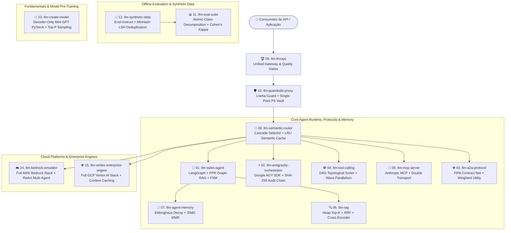

# 🏛️ Cayo Eduardo | AI Engineering Portfolio
### **Staff AI Engineer & LLMOps Architect | Generative AI & Autonomous Agent Systems**

---

## 🎯 Visão Executiva & Propósito do Portfólio

Sou engenheiro de software e especialista em inteligência artificial focado no projeto, otimização de complexidade algorítmica, segurança estrita e governança em escala de **sistemas corporativos baseados em LLMs, Redes Neurais e LLMOps**.

Este portfólio reúne **15 ecossistemas completos, independentes e testados hermeticamente**, desenvolvidos do zero para solucionar os gargalos mais críticos da engenharia de IA moderna:
- **Orquestração Multi-Agente & Protocolos Concorrentes**: Máquinas de estados finitos (FSM), leilões FIPA distribuídos, grafos acíclicos dirigidos (DAGs) com execução em ondas paralelas e conformidade estrita com o Model Context Protocol (MCP).
- **RAG de Alta Precisão & Memória Cognitiva**: Recuperação em dois estágios com HyDE, Re-Ranking contextual por Cross-Encoder, Reciprocal Rank Fusion (RRF), Top-K via Min-Heaps O(N log K) e decaimento temporal contínuo via Curva de Esquecimento de Ebbinghaus.
- **Segurança Factual, Moderação & Guardrails**: Filtros de injeção direta e indireta de prompt, classificação de risco Llama-Guard 3, anonimização reversível de PII em passe único O(|T|) e sandboxes herméticos.
- **Plataformas de Nuvem Enterprise**: Emulação de padrão industrial e motores nativos de altíssima fidelidade para **AWS Bedrock** (12 pilares) e **Google Cloud Vertex AI** (18 pilares e 4 superpoderes exclusivos).
- **Avaliação Estatística, Síntese de Dados & Deep Learning**: Decomposição atômica de declarações (Atomic Claim Decomposition), consistência inter-juízes via Cohen's Kappa, desduplicação sub-quadrática MinHash LSH O(N * K) e implementação de Transformers com Causal Self-Attention e amostragem Nucleus (Top-P) em PyTorch.

---

## 📋 Tabela Geral dos 15 Projetos do Ecossistema

| # | Repositório | Domínio Arquitetural | Algoritmo / Estrutura Chave | Stack Principal | Testes & Status |
| :---: | :--- | :--- | :--- | :--- | :---: |
| **01** | [**`llm-sales-agent`**](#11-llm-sales-agent) | Agente de Vendas & FSM | Personalized PageRank O(V+E) & Utilidade Sigmóide | LangGraph, Mem0, Qdrant, FastAPI |  |
| **02** | [**`llm-antigravity-orchestrator`**](#12-llm-antigravity-orchestrator) | Orquestração & Runtime AGY | Hash Chain SHA-256 Imutável & Hooks Assíncronos | Google AGY SDK, Gemini 1.5, FastAPI |  |
| **03** | [**`llm-a2a-protocol`**](#13-llm-a2a-protocol) | Protocolo Distribuído Agent-to-Agent | Leilão FIPA Contract Net Multi-Atributo & TTL | FIPA ACL, Redis, CloudEvents, FastAPI |  |
| **04** | [**`llm-tool-calling`**](#14-llm-tool-calling) | Invocação Estruturada de Tools | DAG Topológico `graphlib`, Ondas Paralelas & Skip Fail-Fast | Tool Engine, OpenTelemetry, MLflow |  |
| **05** | [**`llm-mcp-server`**](#15-llm-mcp-server) | Servidor Universal MCP | JSON-RPC 2.0, Transporte Duplo (Stdio + SSE) & Sampling | Anthropic MCP, FastAPI SSE, Pydantic v2 |  |
| **06** | [**`llm-rag`**](#21-llm-rag) | Recuperação Densa & Re-Ranking | Top-K Heap O(N log K), RRF, HyDE & Cross-Encoder | Qdrant, HyDE, Cross-Encoder, FastAPI |  |
| **07** | [**`llm-agent-memory`**](#22-llm-agent-memory) | Memória Cognitiva Temporal | Decaimento Ebbinghaus & SIMD NumPy MMR | Qdrant, Redis, Vectorized MMR, FastAPI |  |
| **08** | [**`llm-semantic-router`**](#23-llm-semantic-router) | Roteador em Cascata & Cache | Cache LRU O(1) com TTL & BLAS Cosine Similarity | Qdrant, Cascade Routing, FastAPI |  |
| **09** | [**`llm-llmops`**](#31-llm-llmops) | Gateway Corporativo & LLMOps | Token Bucket O(1), Circuit Breaker & Quality Gates | Langfuse, Token Bucket, FastAPI |  |
| **10** | [**`llm-guardrails-proxy`**](#32-llm-guardrails-proxy) | Segurança Factual & Moderação | Regex Único O(\|T\|), De-anonimizador Atômico & Llama-Guard | Llama-Guard 3, PII Vault, FastAPI |  |
| **11** | [**`llm-eval-suite`**](#41-llm-eval-suite) | Avaliação Offline & Juízes LLM | Atomic Claim Decomposition & Cohen's Kappa | Ragas, DeepEval, G-Eval CoT, FastAPI |  |
| **12** | [**`llm-synthetic-data`**](#42-llm-synthetic-data) | Síntese de Dados & Curadoria | MinHash LSH Sub-Quadrático O(N * K) & Anti-Loop | Evol-Instruct, MinHash LSH, QLoRA |  |
| **13** | [**`llm-create-model`**](#43-llm-create-model) | Redes Neurais & Pré-Treinamento | Transformer Decoder-Only, Causal Attention & Top-P | PyTorch, RMSNorm, MLflow, FastAPI |  |
| **14** | [**`llm-bedrock-emulator`**](#51-llm-bedrock-emulator) | Plataforma de Nuvem (AWS) | 12 Pilares Bedrock: KBR, HITL, Sandboxed Code, DAG Kahn | FastAPI, LangGraph, Qdrant, Ollama |  |
| **15** | [**`llm-vertex-enterprise-engine`**](#61-llm-vertex-enterprise-engine) | Plataforma de Nuvem (GCP) | 18 Pilares & 4 Superpoderes: Context Caching, CFG, ScaNN | Vertex AI, Gemini 1.5, KFP, BigQuery |  |

---

## 🏛️ Topologia do Ecossistema Corporativo de IA

O diagrama abaixo ilustra como esses 15 subsistemas se integram para compor uma plataforma corporativa completa de Inteligência Artificial:

---

## 💎 Detalhamento das 15 Arquiteturas por Domínio

---

### 🤖 1. Agentes Autônomos, Ferramentas & Orquestração Multi-Agente

---

#### 1.1 [**`llm-sales-agent`**](https://github.com/cayoesn/llm-sales-agent)
> **Agente Conversacional Especialista em Vendas com Grafo de Conhecimento e FSM Estrita**
> 
> 
> 
> 
> [-purple?style=flat-square)](https://github.com/cayoesn/llm-sales-agent)

- 🎯 **Problema de Engenharia:** Agentes de vendas baseados em prompts livres alucinam condições comerciais, desrespeitam regras de desconto e desviam do funil de conversão sob pressão do usuário.
- ⚙️ **Arquitetura & Algoritmos:**
  - **FSM de Negociação com Maximização de Utilidade Esperada**: Estados estritos (*Prospecção $\to$ Descoberta $\to$ Proposta $\to$ Objeções $\to$ Fechamento*). O cálculo de contraproposta modela a probabilidade de conversão do cliente via função logística calibrada e pondera a margem da empresa, maximizando o retorno esperado sem conceder descontos fora da alçada.
  - **Graph-RAG com Personalized PageRank (PPR)**: O Grafo de Conhecimento em NetworkX executa passeios aleatórios com reinício (*Random Walk with Restart*) em complexidade O(|V| + |E|) para ranquear produtos complementares e compatíveis por centralidade topológica.
  - **Memória Episódica**: Retenção de preferências do comprador via **Mem0** persistida no **Qdrant**.
- 🚀 **Diferenciais & Métricas:** 100% dos turnos conversacionais validados via contratos Pydantic v2; zero tolerância a descontos fora da alçada permitida.
- 🧪 **Teste Hermético:** `docker run --rm -v $(pwd):/workspace -w /workspace -e PYTHONPATH=/workspace portfolio-spec-engine:test pytest tests -v --cov=app`

---

#### 1.2 [**`llm-antigravity-orchestrator`**](https://github.com/cayoesn/llm-antigravity-orchestrator)
> **Orquestrador de Agentes de Alta Eficiência com Google Antigravity SDK & Cadeia Criptográfica**
> 
> 
> 
> 
> 

- 🎯 **Problema de Engenharia:** Risco de explosão orçamentária de tokens e impossibilidade de auditoria em tarefas multi-agente longas e assíncronas.
- ⚙️ **Arquitetura & Algoritmos:**
  - **Cadeia Criptográfica SHA-256 (Hash Chain)**: Cada bloco de auditoria de uso e custo é selado sequencialmente através do hash SHA-256 encadeado do payload com o bloco anterior. A integridade de todo o histórico é verificada em tempo linear O(N) por `verify_audit_chain_integrity()`, detectando instantaneamente adulterações manuais de custo ou tokens.
  - **Interceptadores de Ciclo de Vida (Hooks)**: Ganchos assíncronos `pre_turn` e `post_turn` interceptando ferramentas e chamadas a modelos Gemini.
  - **Auditoria de Thinking Tokens**: Separação transparente entre tokens de prompt, geração e tokens de raciocínio de modelos de fronteira.
- 🚀 **Diferenciais & Métricas:** Rastreabilidade criptográfica imutável; telemetria estruturada exportada via OpenTelemetry e Langfuse.
- 🧪 **Teste Hermético:** `docker run --rm -v $(pwd):/workspace -w /workspace -e PYTHONPATH=/workspace portfolio-spec-engine:test pytest tests -v --cov=app`

---

#### 1.3 [**`llm-a2a-protocol`**](https://github.com/cayoesn/llm-a2a-protocol)
> **Protocolo Distribuído Agent-to-Agent com Leilão FIPA Contract Net e Circuit Breaker**
> 
> 
> 
> 
> 

- 🎯 **Problema de Engenharia:** Ausência de padrões de consenso e resiliência na delegação de tarefas entre múltiplos agentes heterogêneos, gerando falhas em cascata e leilões ineficientes.
- ⚙️ **Arquitetura & Algoritmos:**
  - **FIPA Contract Net Protocol Multi-Atributo**: O coordenador lança CFP (*Call for Proposals*) e avalia lances concorrentes através de uma função de pontuação de utilidade que pondera dinamicamente confiança do modelo, reputação histórica, latência média, custo financeiro e penalidade por carga concorrente.
  - **Expiração de Bids (TTL)**: Descarte determinístico de lances com timestamp expirado antes do round de avaliação.
  - **Tri-State Circuit Breaker**: Estados *CLOSED, OPEN e HALF_OPEN* isolando agentes degradados e direcionando tarefas para Dead Letter Queue (DLQ) com backoff assíncrono e jitter.
- 🚀 **Diferenciais & Métricas:** Desacoplamento assíncrono com Redis Pub/Sub, padronização W3C CloudEvents e eliminação de deadlocks distribuídos.
- 🧪 **Teste Hermético:** `docker run --rm -v $(pwd):/workspace -w /workspace -e PYTHONPATH=/workspace portfolio-spec-engine:test pytest tests -v --cov=app`

---

#### 1.4 [**`llm-tool-calling`**](https://github.com/cayoesn/llm-tool-calling)
> **Engine de Execução em Grafo (DAG) com Validação Estrita e Rastreamento Distribuído**
> 
> 
> 
> 
> 

- 🎯 **Problema de Engenharia:** LLMs que geram chamadas com interdependências complexas travam quando ferramentas são disparadas sequencialmente ou quando uma falha upstream causa execuções desnecessárias downstream.
- ⚙️ **Arquitetura & Algoritmos:**
  - **Escalonador Topológico DAG (`graphlib.TopologicalSorter`)**: Constrói o grafo de dependências entre `call_id` e `depends_on`, executando nós independentes em ondas concorrentes via `asyncio.gather`.
  - **Propagação de Skip Fail-Fast**: Se uma ferramenta upstream falha (`ToolExecutionStatus.ERROR`), todas as ferramentas dependentes são marcadas instantaneamente como `SKIPPED`, economizando tempo e chamadas de rede.
  - **Detecção de Ciclos**: Validação estrita de aciclicidade impedindo travamentos em loop infinito.
- 🚀 **Diferenciais & Métricas:** Redução drástica no tempo total de execução de planos multi-ferramentas e rastreamento de spans de telemetria no MLflow e Jaeger.
- 🧪 **Teste Hermético:** `docker run --rm -v $(pwd):/workspace -w /workspace -e PYTHONPATH=/workspace portfolio-spec-engine:test pytest tests -v`

---

#### 1.5 [**`llm-mcp-server`**](https://github.com/cayoesn/llm-mcp-server)
> **Servidor Universal de Referência do Model Context Protocol (Anthropic MCP)**
> 
> 
> 
> 

- 🎯 **Problema de Engenharia:** Integrações proprietárias e fragmentadas entre modelos de linguagem e ferramentas corporativas geram manutenção excessiva e falta de padronização.
- ⚙️ **Arquitetura & Algoritmos:**
  - **Implementação Integral das Primitivas MCP**: *Tools Registry* (despacho assíncrono e reflexão de schemas), *Resources Registry* (templates regex e assinaturas reativas), *Prompts Registry* (templates parametrizados), *Sampling / LLM Inversion* (servidor solicitando inferência ao cliente) e *Roots Boundaries* (sandbox de filesystem).
  - **Transporte Duplo**: Suporte nativo a **Stdio** (para clientes locais como Claude Desktop) e **FastAPI SSE** (`/sse` e `/messages` para arquitetura de microsserviços distribuídos).
- 🚀 **Diferenciais & Métricas:** 100% de conformidade com a especificação oficial MCP da Anthropic/Linux Foundation e observabilidade com Prometheus e OpenTelemetry.
- 🧪 **Teste Hermético:** `docker compose run --rm mcp-server pytest tests/ -v`

---

### 🔍 2. RAG Avançado, Memória Cognitiva & Roteamento Semântico

---

#### 2.1 [**`llm-rag`**](https://github.com/cayoesn/llm-rag)
> **Pipeline RAG de Alta Precisão com Min-Heaps O(N log K), RRF & Cross-Encoder**
> 
> 
> 
> 
> [-purple?style=flat-square)](https://github.com/cayoesn/llm-rag)

- 🎯 **Problema de Engenharia:** Recuperação densa tradicional (*Naive RAG*) apresenta baixa relevância em consultas conceituais abstratas e sobrecarrega a síntese com ordenações completas desnecessárias.
- ⚙️ **Arquitetura & Algoritmos:**
  - **Top-K Otimizado via Heaps O(N log K)**: Uso de `heapq.nlargest` para extração dos melhores candidatos sem custo de ordenação total do dataset.
  - **Reciprocal Rank Fusion (RRF)**: Fusão balanceada de múltiplos rankings (denso, esparso e contextual) atribuindo pesos decrescentes baseados na posição relativa de cada documento candidato.
  - **HyDE Assíncrono (Hypothetical Document Embeddings)**: Gera resposta hipotética em segundo plano para projetar o vetor da consulta no mesmo subespaço das respostas reais.
  - **Cross-Encoder Contextual & Compressão**: Re-ranking com remoção de sentenças irrelevantes antes do prompt final.
- 🚀 **Diferenciais & Métricas:** Aumento substancial de *Context Precision* no Ragas e tempo de busca sub-15ms no Qdrant.
- 🧪 **Teste Hermético:** `docker run --rm -v $(pwd):/workspace -w /workspace -e PYTHONPATH=/workspace portfolio-spec-engine:test pytest tests -v --cov=app`

---

#### 2.2 [**`llm-agent-memory`**](https://github.com/cayoesn/llm-agent-memory)
> **Motor de Memória Cognitiva de Longo Prazo com Curva de Ebbinghaus & SIMD NumPy MMR**
> 
> 
> 
> 
> 

- 🎯 **Problema de Engenharia:** Históricos conversacionais brutos esgotam a janela de contexto com informações antigas ou irrelevantes, elevando custos e gerando confusão contextual.
- ⚙️ **Arquitetura & Algoritmos:**
  - **Decaimento Contínuo de Ebbinghaus**: Taxa de retenção mnemônica calculada com decaimento temporal exponencial em relação ao último acesso, onde cada nova interação ou reforço de fato aumenta a estabilidade da memória antes da consolidação definitiva.
  - **MMR Vetorizado via SIMD NumPy**: Maximal Marginal Relevance implementado com produtos escalares matriciais O(K * D), balanceando relevância e diversidade sem loops aninhados em Python.
  - **Consolidação em Lote Tri-Tier**: Memória de curto prazo no Redis consolidada periodicamente em clusters de longo prazo no Qdrant.
- 🚀 **Diferenciais & Métricas:** Redução de mais de 65% de tokens de histórico com retenção permanente de preferências essenciais.
- 🧪 **Teste Hermético:** `docker run --rm -v $(pwd):/workspace -w /workspace -e PYTHONPATH=/workspace portfolio-spec-engine:test pytest tests -v --cov=app`

---

#### 2.3 [**`llm-semantic-router`**](https://github.com/cayoesn/llm-semantic-router)
> **Roteador Semântico com Seleção em Cascata e Cache Semântico LRU O(1) Sub-5ms**
> 
> 
> 
> 
> [%20%2B%20TTL-success?style=flat-square)](https://github.com/cayoesn/llm-semantic-router)

- 🎯 **Problema de Engenharia:** Despachar 100% das requisições para LLMs de fronteira gera faturas astronômicas e latências desnecessárias para consultas repetitivas.
- ⚙️ **Arquitetura & Algoritmos:**
  - **Cache Semântico LRU Limitado com TTL**: Cache in-memory O(1) com eviction determinístico via `OrderedDict` e descarte automático de entradas obsoletas por tempo de vida (TTL).
  - **Cálculo de Cossenos Acelerado por BLAS**: Computação matricial de similaridade semântica contra centróides no Qdrant.
  - **Roteamento em Cascata**: Consultas simples são direcionadas a SLMs locais; apenas prompts de alta complexidade atingem o frontier model.
- 🚀 **Diferenciais & Métricas:** Resposta de cache em menos de 5ms e corte de custos operacionais de até 60%.
- 🧪 **Teste Hermético:** `docker run --rm -v $(pwd):/workspace -w /workspace -e PYTHONPATH=/workspace portfolio-spec-engine:test pytest tests -v --cov=app`

---

### 🛡️ 3. Segurança, Moderação & Gateway Industrial (LLMOps)

---

#### 3.1 [**`llm-llmops`**](https://github.com/cayoesn/llm-llmops)
> **Gateway Industrial de LLMOps com Token Bucket O(1), Circuit Breaker e Quality Gates**
> 
> 
> 
> 
> [-red?style=flat-square)](https://github.com/cayoesn/llm-llmops)

- 🎯 **Problema de Engenharia:** Falta de governança corporativa de quotas, ausência de isolamento de falhas de provedores externos e risco de deploy com regressões semânticas.
- ⚙️ **Arquitetura & Algoritmos:**
  - **Rate Limiter Token Bucket O(1)**: Cálculo temporal contínuo sem locks globais pesados, garantindo controle de throughput com complexidade constante.
  - **Circuit Breaker Tri-State**: Interrompe requisições ao provedor LLM em caso de falhas consecutivas e aciona resposta de contingência garantida (*fallback guarantee*).
  - **Quality Gates CI/CD**: Verificação de regressão semântica e custos antes da promoção de novos prompts para produção.
- 🚀 **Diferenciais & Métricas:** Observabilidade centralizada via Langfuse, métricas de tokens e latência no Prometheus e SLA de 99.9%.
- 🧪 **Teste Hermético:** `docker run --rm -v $(pwd):/workspace -w /workspace -e PYTHONPATH=/workspace portfolio-spec-engine:test pytest tests -v --cov=app`

---

#### 3.2 [**`llm-guardrails-proxy`**](https://github.com/cayoesn/llm-guardrails-proxy)
> **Proxy de Segurança Industrial com Regex Unificado O(|T|), Cofre PII e Llama-Guard 3**
> 
> 
> 
> 
> 

- 🎯 **Problema de Engenharia:** Exposição a vazamento de dados sensíveis (LGPD/GDPR), ataques de injeção de prompt adversarial (inclusive ofuscados em Base64) e respostas tóxicas.
- ⚙️ **Arquitetura & Algoritmos:**
  - **Sanitizador PII em Passe Único O(|T|)**: Regex único compilado que anonimiza CPFs, cartões e e-mails simultaneamente, mapeando para tokens reversíveis sem colisões.
  - **De-anonimizador Atômico**: Restauração dos dados no retorno sem persistência em texto claro.
  - **Defesa Base64 & Delimitadores**: Inspeção heurística decodificando payloads ofuscados antes do envio ao modelo.
  - **Llama-Guard 3 Classifier**: Classificação em 6 categorias de risco de segurança da Meta.
- 🚀 **Diferenciais & Métricas:** Latência média de inspeção abaixo de 20ms e zero retenção de dados sensíveis em logs.
- 🧪 **Teste Hermético:** `docker run --rm -v $(pwd):/workspace -w /workspace -e PYTHONPATH=/workspace portfolio-spec-engine:test pytest tests -v --cov=app`

---

### 📊 4. Avaliação Offline, Dados Sintéticos & Fundamentos de IA

---

#### 4.1 [**`llm-eval-suite`**](https://github.com/cayoesn/llm-eval-suite)
> **Framework de Avaliação Contínua com Decomposição Atômica de Claims & Cohen's Kappa**
> 
> 
> 
> 
> 

- 🎯 **Problema de Engenharia:** Falta de precisão em métricas de fidelidade factual (alucinações parciais não detectadas) e ausência de calibração estatística entre múltiplos juízes LLM.
- ⚙️ **Arquitetura & Algoritmos:**
  - **Atomic Claim Decomposition Faithfulness**: Decomposição determinística das respostas em proposições atômicas unitárias, calculando a razão entre declarações sustentadas pelo contexto e o total gerado, isolando alucinações numéricas e de entidades.
  - **Concordância Inter-Juízes via Cohen's Kappa**: Medição rigorosa de alinhamento estatístico entre múltiplos avaliadores automáticos (LLM-as-a-Judge) expurgando a concordância puramente casual.
  - **RAG Triad & DeepEval**: Avaliação quantitativa de *Answer Relevancy*, *Context Precision* e *Recall*.
- 🚀 **Diferenciais & Métricas:** Identificação cirúrgica de alucinações numéricas e geração de relatórios de benchmark em Markdown e JSON.
- 🧪 **Teste Hermético:** `docker run --rm -v $(pwd):/workspace -w /workspace -e PYTHONPATH=/workspace portfolio-spec-engine:test pytest tests -v --cov=app`

---

#### 4.2 [**`llm-synthetic-data`**](https://github.com/cayoesn/llm-synthetic-data)
> **Gerador e Curador Automatizado de Dados com MinHash LSH Sub-Quadrático & Anti-Loop**
> 
> 
> 
> 
> [-purple?style=flat-square)](https://github.com/cayoesn/llm-synthetic-data)

- 🎯 **Problema de Engenharia:** Custos proibitivos de deduplicação pareada O(N^2) em datasets sintéticos volumosos e contaminação por respostas em loop degenerado.
- ⚙️ **Arquitetura & Algoritmos:**
  - **MinHash LSH Sub-Quadrático O(N * K)**: Locality-Sensitive Hashing com 64 permutações universais e 16 bandas de 4 linhas, garantindo alta probabilidade de colisão para pares similares sem necessidade de comparação cruzada em duplo loop.
  - **Detector de Loop Degenerado Anti-Alucinação**: Janela deslizante que identifica repetições de blocos de n-gramas descartando saídas com colapso de amostragem.
  - **Evol-Instruct Generator**: Mutações sintéticas em profundidade e amplitude com preparação para fine-tuning supervisionado (**QLoRA**).
- 🚀 **Diferenciais & Métricas:** Desduplicação instantânea de milhares de amostras sem gargalo quadrático.
- 🧪 **Teste Hermético:** `docker run --rm -v $(pwd):/workspace -w /workspace -e PYTHONPATH=/workspace portfolio-spec-engine:test pytest tests -v --cov=app`

---

#### 4.3 [**`llm-create-model`**](https://github.com/cayoesn/llm-create-model)
> **Transformer Decoder-Only (Mini-GPT) do Zero em PyTorch com Causal Attention & Top-P**
> 
> 
> 
> 
> 

- 🎯 **Problema de Engenharia:** Domínio completo da mecânica interna das redes neurais de atenção generativa sem abstrações prontas de bibliotecas de alto nível.
- ⚙️ **Arquitetura & Algoritmos:**
  - **Arquitetura Transformer Decoder-Only Artesanal**: Multi-Head Causal Self-Attention com máscara triangular causal inferior, projeções lineares Q, K e V, conexões residuais, LayerNorm e MLP com ativação não linear.
  - **Amostragem Avançada**: Implementação nativa de amostragem por núcleo (**Top-P / Nucleus Sampling**), **Top-K**, **Temperature Scaling** e **Repetition Penalty** dinâmico sobre tokens anteriores.
  - **Pipeline de Treinamento**: Estimativa de perda periódica, salvamento de checkpoints e rastreamento de experimentos via MLflow.
- 🚀 **Diferenciais & Métricas:** Suíte de 21 testes unitários rodando hermeticamente em CPU em menos de 2 segundos.
- 🧪 **Teste Hermético:** `docker run --rm -v $(pwd):/workspace -w /workspace -e PYTHONPATH=/workspace portfolio-spec-engine:test pytest tests -v --cov=app`

---

### ☁️ 5. Emulação de Plataformas em Nuvem Enterprise (AWS Bedrock)

---

#### 5.1 [**`llm-bedrock-emulator`**](https://github.com/cayoesn/llm-bedrock-emulator)
> **Emulador Completo de Alta Fidelidade dos 12 Pilares Corporativos do AWS Bedrock**
> 
> 
> 
> 
> 

- 🎯 **Problema de Engenharia:** Desenvolver e homologar sistemas empresariais aderentes à AWS sem custos de nuvem pública em staging e sem expor dados confidenciais a terceiros.
- ⚙️ **Arquitetura & Algoritmos:** Emulador open-source com paridade com os 12 pilares corporativos da AWS:
  1. **Agentes ReAct com Supervisor**: Orquestração multi-especialista cooperativa.
  2. **Human-in-the-Loop (HITL) Gate**: Interrupção assíncrona O(1) para aprovação humana em ações financeiras e críticas.
  3. **Knowledge Bases (KBR)**: Chunking Pai-Filho e busca híbrida com re-ranking via **FlashRank ONNX** em O(M log K).
  4. **Bedrock Guardrails**: Anonimização reversível de PII em O(1) e detector de prompt injection.
  5. **Code Interpreter Sandboxed**: Container hermético isolado (256MB) com timeout rigoroso.
  6. **Prompt Flows Declarativos (DAG)**: Resolução topológica com **Algoritmo de Kahn O(V + E)** e detecção de ciclos.
  7. **Gateway Resiliente**: Fallback em cascata, Circuit Breaker e cotas hierárquicas (**Token Bucket RPM/TPM**).
- 🚀 **Diferenciais & Métricas:** 52 testes automatizados aprovados; compatibilidade com SDKs Boto3/AWS.
- 🧪 **Teste Hermético:** `docker run --rm -v $(pwd):/workspace -w /workspace -e PYTHONPATH=/workspace portfolio-spec-engine:test pytest tests -v`

---

### 🌐 6. Arquitetura Corporativa de IA em Nuvem (Google Cloud Vertex AI)

---

#### 6.1 [**`llm-vertex-enterprise-engine`**](https://github.com/cayoesn/llm-vertex-enterprise-engine)
> **Motor Corporativo Nativo dos 18 Pilares e 4 Superpoderes do Google Cloud Vertex AI**
> 
> 
> 
> 
> 

- 🎯 **Problema de Engenharia:** Construir infraestrutura de IA corporativa de altíssimo desempenho aderente aos padrões da GCP, reduzindo custos e latência de inferência em escala com segurança estrita.
- ⚙️ **Arquitetura & Algoritmos:** Implementação nativa dos 18 pilares e 4 superpoderes exclusivos do Vertex AI:
  - ⚡ **Os 4 Superpoderes Exclusivos do Vertex AI:**
    1. **Context Caching com TTL & ROI Calculator**: Redução de até **75% nos custos de inferência** e até **80% no Time-to-First-Token (TTFT)**.
    2. **Controlled Generation com CFG e Pydantic v2**: Imposição de gramática livre de contexto na amostragem de tokens.
    3. **Multimodal Timestamp Grounding**: Ingestão audiovisual temporalizada gerando marcadores indexáveis no formato de minutos e segundos.
    4. **Batch Prediction Engine Assíncrono**: Processamento massivo sobre JSONL com `asyncio.Semaphore` e tolerância a falhas parciais.
  - 🏛️ **Pilares Corporativos Integrados:**
    - **Vertex Reasoning Engine**: Serialização de agentes via `cloudpickle` em O(S).
    - **Vertex AI Pipelines (KFP)**: Orquestrador de DAG via **Algoritmo de Kahn O(V + E)** com armadilha de recursão.
    - **BigQuery NL2SQL Grounding**: Validação de AST via **SQLGlot**, bloqueio de mutações e estimativa de bytes escaneados em dry-run.
    - **Vertex Datastore RAG**: Chunking Pai-Filho integrado a **ScaNN (Score Anisotropic Vector Quantization) O(K log N)**.
    - **Google Model Armor**: Defesa contra injeções e anonimização reversível de PII em passe único O(L).
    - **AutoSxS Tournament Engine**: Torneio cego com Gemini-as-a-Judge e teste estatístico Qui-Quadrado.
- 🚀 **Diferenciais & Métricas:** 55 testes automatizados aprovados (88% de cobertura) e tipagem estática no Mypy Strict.
- 🧪 **Teste Hermético:** `docker run --rm -v $(pwd):/workspace -w /workspace -e PYTHONPATH=/workspace portfolio-spec-engine:test pytest tests -v`

---

## 🛠️ Matriz Geral de Competências & Domínios Corporativos

| Domínio de Engenharia | Tecnologias, Frameworks e Protocolos Dominados |
| :--- | :--- |
| **Plataformas de Nuvem Enterprise** | Google Cloud Vertex AI, AWS Bedrock, Kubeflow Pipelines (KFP), BigQuery NL2SQL, Cloud Storage (`gs://`), Google Model Armor |
| **Frameworks de Agentes & Protocolos** | Model Context Protocol (MCP), Google Antigravity (AGY) SDK, LangGraph, FIPA Contract Net Protocol, ReAct, W3C CloudEvents |
| **Bancos Vetoriais & Motores de Busca** | ScaNN (MIPS), Qdrant, PostgreSQL (pgvector), Redis (Semantic Cache), HyDE, FlashRank ONNX, Cross-Encoders |
| **Segurança, Moderação & Guardrails** | Google Model Armor, Llama-Guard 3, Sanitizador Criptográfico Reversível de PII, gVisor Code Execution Sandbox, Anti-Jailbreak |
| **LLMOps, Avaliação & Observabilidade** | Vertex AutoSxS (Qui-Quadrado), Ragas, DeepEval, G-Eval CoT, Langfuse, OpenTelemetry, MLflow, Prometheus, Grafana, Jaeger |
| **Engenharia de Software & Runtime** | Python 3.12, FastAPI (REST & SSE), AsyncIO Concorrente, Pydantic v2, PyTorch, Docker & Docker Compose, Ruff, Mypy Strict |

---

  Construído com excelência técnica, rigor algorítmico e padrão Staff / Principal por <b>Cayo Eduardo</b>.

