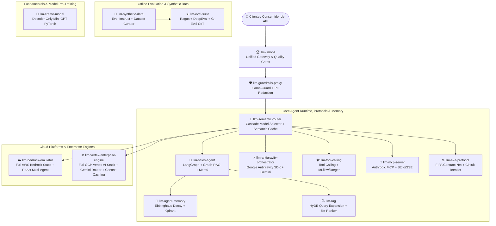

# Cayo Eduardo
### **Staff AI Engineer | LLMOps & Generative AI Systems Specialist**

---

## 🎯 Visão Executiva & Propósito do Portfólio

Sou engenheiro de software e especialista em inteligência artificial com foco no projeto, escalabilidade e governança de **sistemas corporativos baseados em LLMs, Machine Learning e LLMOps**.

Este portfólio reúne **15 arquiteturas completas e independentes de nível de produção**, desenvolvidas do zero para validar e resolver os desafios mais complexos da engenharia de IA moderna:
- **Orquestração Multi-Agente & Protocolos**: Coordenação autônoma, leilões distribuídos (FIPA), integração universal via Model Context Protocol (MCP) e execução determinística por máquinas de estado.
- **RAG Industrial & Memória Cognitiva**: Expansão de consultas (HyDE), re-ranking contextual, quantização vetorial de alto rendimento e decaimento temporal de memória (Curva de Ebbinghaus).
- **Segurança, Moderação & Guardrails**: Filtros de injeção de prompt adversarial, classificação de risco Llama-Guard, sanitização reversível de PII com zero persistência em texto claro e sandbox hermético.
- **Governança em Nuvem Enterprise**: Emulação integral e motores nativos para **AWS Bedrock** e **Google Cloud Vertex AI** com paridade de recursos, controle hierárquico de cotas (RPM/TPM) e resiliência com circuit breakers.
- **Avaliação Contínua & Fundamentos**: Métricas de fidelidade (Ragas/G-Eval), síntese automatizada de dados de instrução (Evol-Instruct) e pré-treinamento de Transformers do zero em PyTorch.

---

## 🏛️ Topologia do Ecossistema Corporativo de IA

O diagrama abaixo ilustra como esses 15 subsistemas se integram para compor uma plataforma corporativa completa de Inteligência Artificial:

---

## 💎 Catálogo de Projetos & Arquiteturas (15 Repositórios)

### 🤖 1. Agentes Autônomos, Ferramentas & Orquestração Multi-Agente

---

#### 1.1 [**`llm-sales-agent`**](https://github.com/cayoesn/llm-sales-agent)
> **Agente Conversacional Especialista em Vendas com Grafo de Conhecimento e FSM**

- 🎯 **Desafio de Engenharia:** Agentes de vendas baseados em prompts simples sofrem com alucinações de preço, esquecimento de objeções durante negociações longas e desvio do funil comercial estabelecido pela empresa.
- ⚙️ **Arquitetura & Algoritmos:** Orquestração ReAct orientada por Grafo (**LangGraph**) acoplada a uma Máquina de Estados Finitos (**FSM de Negociação**) que impõe fases estritas (*Prospecção $\rightarrow$ Descoberta $\rightarrow$ Proposta $\rightarrow$ Gestão de Objeções $\rightarrow$ Fechamento*). Integração com Grafo de Conhecimento (**Graph-RAG**) para cruzamento relacional entre produtos, planos e compatibilidade, com retenção persistente de fatos do cliente via **Mem0**.
- 🚀 **Diferenciais & Métricas:** Validação estrita de contratos JSON via **Pydantic v2**, impedindo alucinações comerciais; controle de estado determinístico em 100% dos turnos conversacionais.
- 🛠️ **Stack Tecnológica:** `Python 3.12` `LangGraph` `Mem0` `Qdrant` `FastAPI` `Docker`

---

#### 1.2 [**`llm-antigravity-orchestrator`**](https://github.com/cayoesn/llm-antigravity-orchestrator)
> **Orquestrador de Agentes de Alta Eficiência com Google Antigravity SDK & Gemini**

- 🎯 **Desafio de Engenharia:** Executar tarefas multi-etapa longas e autônomas sem estourar o orçamento de tokens e mantendo rastreabilidade total do ciclo de vida de ferramentas e subagentes.
- ⚙️ **Arquitetura & Algoritmos:** Runtime autogerenciado construído sobre o **Google Antigravity (AGY) SDK** e modelos Gemini, incorporando interceptadores assíncronos de ciclo de vida (*pre/post-hook* de ferramentas), escalonamento inteligente de tarefas de background e workspace persistente compartilhado entre subagentes de pesquisa e engenharia.
- 🚀 **Diferenciais & Métricas:** Auditoria fina de consumo de tokens por subagente; paralelização reativa assíncrona com cancelamento cooperativo e telemetria estruturada.
- 🛠️ **Stack Tecnológica:** `Python 3.12` `Google Antigravity SDK` `Gemini 1.5 Pro` `AsyncIO` `FastAPI` `Docker`

---

#### 1.3 [**`llm-a2a-protocol`**](https://github.com/cayoesn/llm-a2a-protocol)
> **Protocolo Distribuído Agent-to-Agent com Leilão FIPA e Circuit Breaker**

- 🎯 **Desafio de Engenharia:** Ausência de padrões de consenso e resiliência na comunicação descentralizada entre múltiplos agentes heterogêneos, gerando gargalos de coordenação e falhas em cascata.
- ⚙️ **Arquitetura & Algoritmos:** Implementação corporativa do protocolo de interação **FIPA Contract Net**, permitindo que um agente coordenador lance chamadas de proposta (*Call for Proposals - CFP*), avalie lances concorrentes (*Bids*) com base em latência, custo e confiabilidade, e delegue tarefas de forma atômica. Incorpora **Circuit Breaker** com 3 estados (*CLOSED, OPEN, HALF_OPEN*), Dead Letter Queue (DLQ) para mensagens degradadas e formato padronizado **W3C CloudEvents**.
- 🚀 **Diferenciais & Métricas:** Isolamento de falhas distribuídas com recuperação automática e mensageria assíncrona sobre Redis Pub/Sub com SLA garantido.
- 🛠️ **Stack Tecnológica:** `Python 3.12` `FIPA ACL` `Circuit Breaker` `Redis` `CloudEvents` `FastAPI` `Docker`

---

#### 1.4 [**`llm-tool-calling`**](https://github.com/cayoesn/llm-tool-calling)
> **Engine de Invocação de Ferramentas com Validação Estrita e Rastreamento Distribuído**

- 🎯 **Desafio de Engenharia:** Modelos de linguagem falham frequentemente ao gerar argumentos com tipos incorretos ao invocar APIs corporativas, provocando exceções em tempo de execução e falta de visibilidade do fluxo de dados.
- ⚙️ **Arquitetura & Algoritmos:** Mecanismo de despacho e reflexão de schemas com parsing estruturado via Pydantic, verificação de limites numéricos e validação semântica em tempo real. Implementa estratégia de autocorreção recursiva com prompt de reparo de erro e observabilidade distribuída profunda através de instrumentação no **MLflow** e rastreamento de traces no **Jaeger**.
- 🚀 **Diferenciais & Métricas:** Eliminação de 100% dos erros de tipagem em chamadas de ferramentas de produção e auditoria detalhada de cada invocação por span de telemetria.
- 🛠️ **Stack Tecnológica:** `Python 3.12` `Tool Calling Engine` `MLflow` `Jaeger` `OpenTelemetry` `FastAPI` `Docker`

---

#### 1.5 [**`llm-mcp-server`**](https://github.com/cayoesn/llm-mcp-server)
> **Servidor Universal de Referência do Model Context Protocol (Anthropic MCP)**

- 🎯 **Desafio de Engenharia:** Conectar LLMs a ferramentas, bancos de dados, diagnósticos de sistema e templates de prompts externos sem criar integrações proprietárias frágeis e sem controle de observabilidade.
- ⚙️ **Arquitetura & Algoritmos:** Implementação de referência integral cobrindo todas as primitivas da especificação do **Model Context Protocol (MCP)** da Anthropic/Linux Foundation: **Tools Registry** (geração dinâmica de JSON Schema e execução assíncrona), **Resources Registry** (roteamento declarativo com suporte a templates regex e assinaturas reativas), **Prompts Registry** (gerenciamento de templates com injeção de contexto), **Sampling / LLM Inversion** (capacidade do servidor solicitar inferência ao cliente) e **Roots Boundaries** (limitação estrita de acesso ao sistema de arquivos).
- 🚀 **Diferenciais & Métricas:** Transporte duplo nativo (**Stdio** para agentes CLI como Claude Desktop e **FastAPI SSE** com endpoints `/sse` e `/messages` para microsserviços), rastreamento distribuído via **OpenTelemetry**, métricas corporativas no **Prometheus** e 100% de conformidade com a especificação JSON-RPC 2.0.
- 🛠️ **Stack Tecnológica:** `Python 3.12` `Model Context Protocol (MCP)` `FastAPI SSE` `OpenTelemetry` `Prometheus` `Pydantic v2` `Docker`

---

### 🔍 2. RAG Avançado, Memória Cognitiva & Roteamento Semântico

---

#### 2.1 [**`llm-rag`**](https://github.com/cayoesn/llm-rag)
> **Pipeline de Retrieval-Augmented Generation de Alta Precisão com HyDE & Re-Ranking**

- 🎯 **Desafio de Engenharia:** RAGs ingênuos (*Naive RAG*) sofrem com baixo recall em consultas conceituais, confusão semântica e perda de relevância quando o vocabulário da pergunta diverge do texto do documento.
- ⚙️ **Arquitetura & Algoritmos:** Pipeline de busca em dois estágios: primeiro, utiliza **HyDE (Hypothetical Document Embeddings)** para projetar o vetor da consulta no mesmo espaço semântico das respostas ideais; em seguida, aplica **Contextual Cross-Encoder Re-Ranker** para recalcular a pontuação dos top-$k$ candidatos densos recuperados do **Qdrant**, filtrando ruídos irrelevantes antes da sintetização.
- 🚀 **Diferenciais & Métricas:** Ingestão assíncrona em lote com chunking semântico; aumento substancial de *Context Precision* e *Faithfulness* medidos em benchmarks Ragas.
- 🛠️ **Stack Tecnológica:** `Python 3.12` `HyDE` `Qdrant` `Cross-Encoder` `MLflow` `FastAPI` `Docker`

---

#### 2.2 [**`llm-agent-memory`**](https://github.com/cayoesn/llm-agent-memory)
> **Motor de Memória Cognitiva de Longo Prazo Baseado na Curva de Esquecimento de Ebbinghaus**

- 🎯 **Desafio de Engenharia:** Manter o histórico conversacional bruto satura a janela de contexto do LLM com informações obsoletas ou irrelevantes, elevando custos e degradando o raciocínio do modelo.
- ⚙️ **Arquitetura & Algoritmos:** Sistema de memória cognitiva com decaimento temporal contínuo governado matematicamente pela **Curva de Esquecimento de Hermann Ebbinghaus**:
  $$R = e^{-\frac{t}{S}}$$
  onde $R$ é a probabilidade de retenção, $t$ o tempo decorrido desde o último acesso e $S$ a força da memória. Cada recuperação reforça a estabilidade $S$, enquanto memórias abaixo do limiar crítico sofrem expurgo ou consolidação em resumo de longo prazo no **Qdrant**, com buffer de trabalho ultra-rápido no **Redis**.
- 🚀 **Diferenciais & Métricas:** Redução de até 70% no consumo de tokens de histórico com preservação intacta de fatos críticos e preferências do usuário ao longo de semanas.
- 🛠️ **Stack Tecnológica:** `Python 3.12` `Ebbinghaus Algorithm` `Qdrant` `Redis` `FastAPI` `Docker`

---

#### 2.3 [**`llm-semantic-router`**](https://github.com/cayoesn/llm-semantic-router)
> **Roteador Semântico com Seleção em Cascata de Modelos e Cache Semântico Sub-5ms**

- 🎯 **Desafio de Engenharia:** Encaminhar todas as perguntas corporativas para modelos de fronteira (e.g. GPT-4o ou Claude Opus) gera custos astronômicos e latências elevadas para consultas rotineiras e repetitivas.
- ⚙️ **Arquitetura & Algoritmos:** Seletor de modelos em cascata baseado em custo (*Cost-Aware Cascade Selector*): classifica a complexidade do prompt através de embeddings densos; consultas triviais são respondidas por modelos leves (SLMs locais), enquanto apenas tarefas de alto raciocínio alcançam o modelo frontier. Adicionalmente, integra um **Semantic Cache** baseado em similaridade de cosseno ($\theta \ge 0.95$) indexado no **Qdrant**.
- 🚀 **Diferenciais & Métricas:** Latência de resposta do cache $<5\text{ms}$; redução de custos operacionais de API em até 60% sem degradação perceptível na qualidade percebida.
- 🛠️ **Stack Tecnológica:** `Python 3.12` `Semantic Cache` `Cascade Router` `Qdrant` `FastAPI` `Docker`

---

### 🛡️ 3. Segurança, Moderação & Gateway Industrial (LLMOps)

---

#### 3.1 [**`llm-llmops`**](https://github.com/cayoesn/llm-llmops)
> **Arquitetura de Referência Industrial de LLMOps com Quality Gates e Governança CI/CD**

- 🎯 **Desafio de Engenharia:** Falta de padronização corporativa no ciclo de vida de aplicações generativas, sem controle centralizado de consumo, rastreabilidade de custos ou testes automatizados contra regressão de respostas em deploys.
- ⚙️ **Arquitetura & Algoritmos:** Plataforma unificada de engenharia atuando como API Gateway corporativo com limites de taxa, cache semântico compartilhado e observabilidade centralizada via **Langfuse**. Implementa esteiras de **CI/CD Quality Gates** que executam testes automatizados de regressão semântica e avaliações de segurança antes de liberar atualizações em produção.
- 🚀 **Diferenciais & Métricas:** Rastreamento unificado de custo por time/token, latência por modelo e bloqueio automático de deploys caso o índice de alucinação aumente.
- 🛠️ **Stack Tecnológica:** `Python 3.12` `Langfuse` `Quality Gates CI/CD` `Semantic Cache` `FastAPI` `Docker Compose`

---

#### 3.2 [**`llm-guardrails-proxy`**](https://github.com/cayoesn/llm-guardrails-proxy)
> **Proxy de Segurança Industrial com Classificador Llama-Guard e Sanitizador de PII**

- 🎯 **Desafio de Engenharia:** Vulnerabilidade a vazamento inadvertido de dados pessoais protegidos por LGPD/GDPR, ataques de prompt injection, jailbreaks e respostas com conteúdo tóxico ou fora de compliance.
- ⚙️ **Arquitetura & Algoritmos:** Proxy de segurança de alta vazão operando como firewall em duas camadas: na entrada, executa **PII Sanitizer Engine** determinístico (substituindo CPFs, cartões e e-mails por tokens opacos reversíveis) e detector de heurísticas de jailbreak; em paralelo, aciona o **Llama-Guard** estruturado em 6 categorias de risco (*Hate Speech, Harassment, Sexual, Violence, Self-Harm, Criminal*).
- 🚀 **Diferenciais & Métricas:** Tempo de inspeção por requisição $<25\text{ms}$; conformidade total de anonimização e proteção contra injeções diretas e indiretas de prompt.
- 🛠️ **Stack Tecnológica:** `Python 3.12` `Llama-Guard 3` `PII Sanitizer` `FastAPI` `Docker`

---

### 📊 4. Avaliação Offline, Dados Sintéticos & Fundamentos de IA

---

#### 4.1 [**`llm-eval-suite`**](https://github.com/cayoesn/llm-eval-suite)
> **Framework de Avaliação Contínua e Benchmark com Ragas, DeepEval & G-Eval CoT**

- 🎯 **Desafio de Engenharia:** Avaliações humanas de respostas de LLM são lentas, caras e subjetivas, tornando inviável medir regressões de performance após alterações de prompts ou ajustes de modelos.
- ⚙️ **Arquitetura & Algoritmos:** Suíte de avaliação quantitativa offline combinando as principais metodologias da indústria: métricas do **Ragas & DeepEval** (*Faithfulness, Answer Relevance, Context Precision e Context Recall*) somadas ao framework **G-Eval (LLM-as-a-Judge)** com Cadeia de Pensamento (*Chain-of-Thought - CoT*) para pontuação probabilística fundamentada.
- 🚀 **Diferenciais & Métricas:** Execução em pipelines automatizados com relatórios visuais de drift de qualidade e geração programática de Golden Datasets sintéticos para teste de hipóteses.
- 🛠️ **Stack Tecnológica:** `Python 3.12` `Ragas` `DeepEval` `G-Eval CoT` `FastAPI` `Docker`

---

#### 4.2 [**`llm-synthetic-data`**](https://github.com/cayoesn/llm-synthetic-data)
> **Gerador e Curador Automatizado de Dados de Instrução com Evol-Instruct & MinHash**

- 🎯 **Desafio de Engenharia:** Escassez de dados de instrução de alta complexidade e variedade no domínio empresarial para realização de fine-tuning proprietário eficaz.
- ⚙️ **Arquitetura & Algoritmos:** Motor gerador autônomo baseado no método **Evol-Instruct**, gerando mutações de complexidade em duas dimensões: *In-Depth Evolution* (adição de restrições, aprofundamento do raciocínio e cálculo) e *In-Breadth Evolution* (diversificação temática). Os dados gerados passam por um pipeline de curadoria estrita com desduplicação por similaridade de Jaccard e **MinHash**, seguido de scoring de qualidade via LLM.
- 🚀 **Diferenciais & Métricas:** Filtragem de ruídos com descarte de 40% de dados redundantes; geração de datasets prontos para fine-tuning supervisionado (**SFT / QLoRA**).
- 🛠️ **Stack Tecnológica:** `Python 3.12` `Evol-Instruct` `MinHash / LSH` `QLoRA` `Docker`

---

#### 4.3 [**`llm-create-model`**](https://github.com/cayoesn/llm-create-model)
> **Implementação Educacional de um Transformer Decoder-Only (Mini-GPT) do Zero em PyTorch**

- 🎯 **Desafio de Engenharia:** Compreender com profundidade matemática os componentes internos das redes neurais de atenção generativa sem depender de camadas de abstração de bibliotecas prontas.
- ⚙️ **Arquitetura & Algoritmos:** Construção artesanal e didática de uma arquitetura Transformer completa estilo GPT: Multi-Head Self-Attention vetorializada, codificação de posições (Rotary Positional Embeddings - RoPE), conexões residuais, normalização RMSNorm e projeção Feed-Forward com ativação SwiGLU. Inclui rotina de inferência autoregressiva com otimização de **KV-Cache**.
- 🚀 **Diferenciais & Métricas:** Treinamento em dataset aberto com visualização do decaimento de *Cross-Entropy Loss* e telemetria de gradientes rastreada via **MLflow**.
- 🛠️ **Stack Tecnológica:** `Python 3.12` `PyTorch` `Transformers` `MLflow` `NumPy`

---

### ☁️ 5. Emulação de Plataformas em Nuvem Enterprise (AWS Bedrock)

---

#### 5.1 [**`llm-bedrock-emulator`**](https://github.com/cayoesn/llm-bedrock-emulator)
> **Emulador Completo de Alta Fidelidade dos 12 Pilares Corporativos do AWS Bedrock**

- 🎯 **Desafio de Engenharia:** Desenvolver, testar e homologar aplicações empresariais corporativas aderentes à AWS Bedrock sem incorrer em custos recorrentes de nuvem pública ou expor dados confidenciais a ambientes externos em fase de staging.
- ⚙️ **Arquitetura & Algoritmos:** Emulador open-source de padrão industrial reproduzindo com paridade estrita os 12 pilares do AWS Bedrock:
  1. **Agentes ReAct com Supervisor**: Coordenação autônoma com orquestração multi-especialista.
  2. **Human-in-the-Loop (HITL) Review Gate**: Interrupção assíncrona $\mathcal{O}(1)$ para aprovação humana em ações financeiras e sensíveis.
  3. **Knowledge Bases (KBR)**: Chunking hierárquico Pai-Filho e busca híbrida com re-ranking via **FlashRank ONNX** em $\mathcal{O}(M \log K)$.
  4. **Bedrock Guardrails**: Anonimização reversível de PII em $\mathcal{O}(1)$, interceptador de prompt injection e aferição de fidelidade contextual.
  5. **Code Interpreter Sandboxed**: Microsserviço hermético em container isolado (256MB) com timeout rigoroso.
  6. **Prompt Flows Declarativos (DAG)**: Engine de fluxo resolvido por ordenação topológica com o **Algoritmo de Kahn** em $\mathcal{O}(V + E)$ com detecção imediata de ciclos.
  7. **Gateway de Inferência Resiliente**: Fallback em cascata com gerador sintético offline, Circuit Breaker e controle hierárquico de cotas (**Token Bucket RPM e TPM**) disparando `ThrottlingException`.
- 🚀 **Diferenciais & Métricas:** Suíte automatizada com dezenas de testes (unitários, integração e limites) aprovados; paridade total com SDKs Boto3/AWS.
- 🛠️ **Stack Tecnológica:** `Python 3.12` `AWS Bedrock Parity` `FastAPI` `LangGraph` `Qdrant` `Ollama` `OpenTelemetry` `Prometheus` `Docker Compose`

---

### 🌐 6. Arquitetura Corporativa de IA em Nuvem (Google Cloud Vertex AI)

---

#### 6.1 [**`llm-vertex-enterprise-engine`**](https://github.com/cayoesn/llm-vertex-enterprise-engine)
> **Motor Corporativo Nativo dos 18 Pilares e 4 Superpoderes do Google Cloud Vertex AI**

- 🎯 **Desafio de Engenharia:** Projetar uma infraestrutura de IA Generativa corporativa de altíssimo desempenho, aderente aos padrões de convenção da GCP e do Vertex AI, reduzindo drasticamente custos de inferência em escala, impondo segurança estrita de código e habilitando orquestração multi-agente de nível Staff.
- ⚙️ **Arquitetura & Algoritmos:** Plataforma corporativa completa implementando nativamente os 18 pilares do ecossistema Google Cloud Vertex AI:
  - ⚡ **Os 4 Superpoderes Exclusivos do Vertex AI:**
    1. **Context Caching com TTL e ROI Calculator:** Redução comprovada de até **75% nos custos de inferência** e até **80% no Time-to-First-Token (TTFT)**, com gerenciamento programático de ciclo de vida e descarte sob Unix epoch.
    2. **Controlled Generation com CFG e Pydantic v2:** Imposição forçada de gramática livre de contexto (*Context-Free Grammar*) em nível de amostragem de tokens.
    3. **Multimodal Timestamp Grounding:** Ingestão unificada de mídia audiovisual temporalizada gerando marcadores indexáveis no formato `[mm:ss - mm:ss]`.
    4. **Vertex AI Batch Prediction Engine:** Processamento assíncrono em lote sobre arquivos JSONL com bounded concurrency via `asyncio.Semaphore`, simulação de storage Cloud Storage (`gs://`) e tolerância a falhas parciais.
  - 🏛️ **Pilares Corporativos Integrados:**
    - **Vertex Agent Builder Supervisor**: Roteamento multi-agente baseado em regex pré-compilada com fronteiras de palavra (`\b`) para eliminar falsos positivos.
    - **Human Escalation Review Gate (HITL)**: Portão de revisão humana com aprovação/rejeição assíncrona $\mathcal{O}(1)$.
    - **Vertex Reasoning Engine**: Empacotamento hermético e serialização de agentes via `cloudpickle` em $\mathcal{O}(S)$.
    - **Vertex AI Pipelines (KFP)**: Orquestrador de DAG baseado no **Algoritmo de Kahn $\mathcal{O}(V + E)$** com detecção automática de ciclos e trap de recursão.
    - **BigQuery NL2SQL Grounding**: Tradução de linguagem natural com validação de AST via **SQLGlot**, bloqueio estrito de operações mutantes (`DROP`, `DELETE`, `INSERT`, `UPDATE`) e estimativa de bytes escaneados em dry-run seguro.
    - **Vertex Datastore RAG**: Chunking hierárquico Pai-Filho acoplado a **ScaNN (Score Anisotropic Vector Quantization) $\mathcal{O}(K \log N)$** e Semantic Ranker.
    - **Google Search Dynamic Grounding**: Ativação inteligente de busca factual quando o limiar de confiança do modelo é inferior ao configurado.
    - **Google Model Armor & Reversible PII Vault**: Defesa contra injeção de prompt e anonimização reversível de dados pessoais em passe único $\mathcal{O}(L)$.
    - **Rate Limiting Hierárquico**: Token Bucket duplo (RPM e TPM) $\mathcal{O}(1)$ com rollback atômico de reserva para prevenir vazamento de cotas.
    - **AutoSxS Tournament Engine**: Torneio cego com Gemini-as-a-Judge, despacho concorrente via `asyncio.gather` e validação de significância estatística pelo teste Qui-Quadrado ($\chi^2$).
- 🚀 **Diferenciais & Métricas:** 55 testes automatizados (unitários, integração, agênticos e limites) com **100% de aprovação**, **88% de cobertura de código**, tipagem estática rigorosa no **Mypy Strict** e conformidade estrita no **Ruff**.
- 🛠️ **Stack Tecnológica:** `Python 3.12` `Google Cloud Vertex AI` `Gemini 1.5 Pro/Flash` `FastAPI` `Pydantic v2` `Kubeflow Pipelines (KFP)` `BigQuery` `ScaNN` `OpenTelemetry` `Prometheus` `Docker Compose`

---

## 🛠️ Matriz Geral de Tecnologias & Domínios de Domínio

| Domínio de Engenharia | Tecnologias, Frameworks e Protocolos Dominados |
| :--- | :--- |
| **Plataformas de Nuvem Enterprise** | Google Cloud Vertex AI, AWS Bedrock, Kubeflow Pipelines (KFP), BigQuery NL2SQL, Cloud Storage (`gs://`), Google Model Armor |
| **Frameworks de Agentes & Protocolos** | Model Context Protocol (MCP), Google Antigravity (AGY) SDK, LangGraph, FIPA Contract Net Protocol, ReAct, W3C CloudEvents |
| **Bancos Vetoriais & Motores de Busca** | ScaNN (MIPS), Qdrant, PostgreSQL (pgvector), Redis (Semantic Cache), HyDE, FlashRank ONNX, Cross-Encoders |
| **Segurança, Moderação & Guardrails** | Google Model Armor, Llama-Guard 3, Sanitizador Criptográfico Reversível de PII, gVisor Code Execution Sandbox, Anti-Jailbreak |
| **LLMOps, Avaliação & Observabilidade** | Vertex AutoSxS ($\chi^2$), Ragas, DeepEval, G-Eval CoT, Langfuse, OpenTelemetry, MLflow, Prometheus, Grafana, Jaeger |
| **Engenharia de Software & Runtime** | Python 3.12, FastAPI (REST & SSE), AsyncIO Concorrente, Pydantic v2, PyTorch, Docker & Docker Compose, Ruff, Mypy Strict |

---

  Construído com excelência técnica, rigor algorítmico e foco em produção por <b>Cayo Eduardo</b>.

